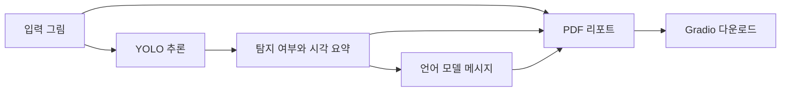

<div align="center">

<a name="그림-객체-탐지와-ai-분석-리포트"></a>
<a name="yolo--gradio--대화형-메시지--pdf"></a>

# 🎨 Drawing Analysis Project

YOLO 탐지 결과를 GPT 대화와 그림 분석 PDF로 연결합니다.

**기술 분류:** 컴퓨터 비전·자연어 처리 › 검출·언어 모델 연결 › 그림 탐지 요약→대화·PDF

`Python`
`YOLO`
`Gradio`

[빠른 시작](#quick-start) · [저장소 구성](#repository-structure) · [실험 설정](#data-settings)

[핵심 구성](#input-processing-output)

</div>

## 🗂️ 자료별 상세 안내

| 자료 | 세부 설명 |
| :--- | :--- |
| 📚 기본 | [📖 내용·근거](docs/versions/stage-1.md) |


[**🗂️ 자료별 상세 안내와 변화 →**](docs/REVISION_INDEX.md)


<a name="overview"></a>

## ✨ 주요 개발 내용

YOLO 그림 탐지, 텍스트 질문, PDF 기록을 연결하는 기본 앱입니다.


- analyze_and_suggest는 업로드 그림의 탐지 결과를 분석·제안 흐름으로 전달합니다.
- ask_gpt는 텍스트 대화, build_pdf는 대화 결과의 PDF 생성을 담당합니다.
- 학습용 자료 준비와 YOLO 학습은 별도 스크립트로 구성했습니다.

**자료별 안내:** [기본](docs/versions/stage-1.md) · [전체 기록](docs/VERSIONS.md)

<a name="preview"></a>

<a name="input-processing-output"></a>

## 🔄 입력·처리·출력

| 단계 | 이 프로젝트에서 다루는 내용 |
| :--- | :--- |
| 📥 입력 | 그림 이미지·사용자 텍스트 |
| ⚙️ 처리 | YOLO 탐지 여부 요약을 GPT-4o-mini 텍스트 요청에 연결 |
| 📤 출력 | 대화 메시지·입력 그림을 담은 PDF |


---

<a name="introduction"></a>

## ✨ 프로젝트 소개

YOLO 추론, 언어 모델 메시지 생성, PDF 출력을 하나의 Gradio 화면에서 연결합니다. 별도 스크립트에는 그림 데이터 준비와 YOLO 학습, JSONL 변환 및 미세조정 작업이 담겨 있습니다.

| 기능 | 구현 내용 |
| :--- | :--- |
| 🖼️ 그림 입력 | Gradio 이미지 입력을 임시 이미지로 저장 |
| 🔎 객체 탐지 | 학습된 YOLO 가중치로 추론하고 탐지 유무 확인 |
| 💬 메시지 생성 | 탐지 성공·실패 요약을 바탕으로 대화형 메시지 요청 |
| 📄 PDF 생성 | 분석 시각·요약·메시지·입력 그림을 리포트로 구성 |
| 🧪 데이터 준비 | 그림 생성, 패치 분할, 학습 라벨 구성 스크립트 |
| 🧠 학습 도구 | YOLO 학습과 JSONL·미세조정 보조 코드 |



<a name="repository-structure"></a>

## 📁 저장소 구성

주요 파일 구성은 다음과 같습니다.

```text
.
├── app.py
├── fastAPI.py
├── config.py
├── synthetic_drawings_generator.py
├── yolo_single_object_dataset.py
├── train_yolo_dataset.py
├── train_yolo_pipeline.py
├── csv_to_jsonl.py
├── fine_tuning.py
├── build_and_finetune.py
└── docs/VERSIONS.md
```

- [Gradio 앱](app.py): 입력·추론·대화·PDF 연결.
- [YOLO 학습 파이프라인](train_yolo_pipeline.py): 이미지 분할과 예시 라벨·학습 구성.
- [그림 생성](synthetic_drawings_generator.py)과 [단일 객체 데이터 준비](yolo_single_object_dataset.py).
- [JSONL 변환](csv_to_jsonl.py), [미세조정 코드](fine_tuning.py), [버전 기록](docs/VERSIONS.md).

<a name="관련-연구와-공개-범위"></a>

### 🔬 관련 연구와 공개 범위

[미술치료 대화 연구](https://github.com/PUVKID/Art-Therapy-Dialogue-Project)는 같은 YOLO 탐지 요약·대화·PDF 설계를 논문과 노트북으로 설명합니다. 이 저장소는 데이터 생성·학습·미세조정·API 진입점을 포함한 Python 코드 구성을 보존합니다. 그림 분석의 같은 흐름을 다루지만, 여기서는 Python 실행 파일과 학습 보조 도구를, 대화 연구 저장소에서는 최종 논문과 노트북을 살펴볼 수 있습니다.

## 🧩 주요 기술과 처리 흐름

`app.py`는 OpenCV로 입력을 저장하고 Ultralytics YOLO를 호출합니다. 추론 설정은 `conf=0.05`, `imgsz=640`입니다. 언어 모델에는 탐지 성공·실패와 분석 시각을 담은 텍스트 요약을 전달합니다. 이 경로에서 원본 그림 자체나 상세 객체 좌표가 언어 모델로 전달되는 것은 아닙니다.

`build_pdf()`는 FPDF로 메시지와 그림을 문서에 배치합니다. 결과 이미지에는 탐지 상자를 새로 그리지 않고 입력 그림을 그대로 돌려줍니다. `ask_gpt()`는 별도의 텍스트 질문 입력을 처리합니다. 모델 요청 이름은 코드에 지정된 `gpt-4o-mini`이며 실제 서비스 접근 가능 여부는 실행 환경에 따라 확인해야 합니다.

<a name="quick-start"></a>

## 🚀 빠른 시작

저장소 루트에서 Python 환경을 준비합니다.

```powershell
python -m venv .venv
.\.venv\Scripts\python -m pip install gradio ultralytics fpdf2 openai opencv-python
```

1. 본인 환경에 `OPENAI_API_KEY`를 설정합니다.
2. `app.py`의 `YOLO_MODEL_PATH`, `PROJECT_DIR`, `FONT_PATH`를 실제 모델·작업·폰트 경로에 맞춥니다.
3. `INPUT_DIR`에 해당하는 입력 폴더를 준비합니다. 출력 폴더는 코드에서 생성합니다.
4. 앱을 실행합니다.

```powershell
.\.venv\Scripts\python app.py
```

`config.py`의 환경변수와 `app.py`의 자체 경로 설정은 각각 관리합니다. 실행할 진입점에 모델 가중치·입력 그림·폰트 경로를 설정하고 서비스 인증정보를 준비합니다.

<a name="data-settings"></a>

## 📊 데이터 구성과 실험 설정

| 항목 | 확인할 내용 |
| :--- | :--- |
| 그림 입력 | 앱에 넣을 이미지와 읽기·저장 경로 |
| YOLO 가중치 | 해당 그림 객체로 학습된 모델 파일 |
| 리포트 | `result/report.pdf` 경로에 생성하도록 구성 |
| 예시 학습 클래스 | `train_yolo_pipeline.py`의 `door`, `roof`, `tree` |
| 예시 학습 설정 | 30 epochs, 이미지 640, batch 8 |

`train_yolo_pipeline.py`는 고정 위치의 예시 라벨을 생성하고 학습·검증에 같은 이미지 폴더를 지정합니다. 이 구성의 검증 수치는 학습 자료에 대한 적합도를 나타내며, 일반화 성능 평가에는 별도의 정답 라벨과 독립 시험 자료가 필요합니다.

<a name="함께-보관한-학습-경로"></a>

### 🧠 함께 보관한 학습 경로

| 파일 | 입력·출력과 설정 |
| :--- | :--- |
| `synthetic_drawings_generator.py` | 33종 도형을 한 이미지에 조합하고, 학습·검증 각각 50,000장과 YOLO 라벨을 생성하도록 설정 |
| `yolo_single_object_dataset.py` | 33개 클래스별로 단일 객체 이미지를 학습·검증 각각 10,000장씩 생성하도록 설정 |
| `train_yolo_dataset.py` | 이미지 512, batch 16, 50 epoch 단위 목표값을 30회 설정하는 별도 학습 루프 |
| `finetune_samples.py` | 코드에 직접 작성된 문장 10개를 CSV로 저장 |
| `csv_to_jsonl.py` | CSV의 `prompt`·`completion`을 기존 형식 JSONL로 변환 |
| `fine_tuning.py` | JSONL 파일을 외부 API에 올리고 미세조정 작업 생성 |
| `build_and_finetune.py` | 대화형 JSONL 생성 후 기존 CLI의 데이터 준비·학습 명령 호출 |
| `list_finetuning_jops.py` | 계정의 미세조정 작업 목록 조회 |
| `train_result_check.py` | 지정된 가중치와 이미지 한 장으로 `conf=0.25` 추론 |
| `fastAPI.py` | `/gpt` POST 요청의 텍스트를 별도 모델 요청으로 전달 |

위 생성 장수는 **코드의 목표 설정**입니다. `train_yolo_dataset.py`는 검증 폴더가 없으면 학습 폴더를 복사하고, `resume_flag`를 계산하지만 `model.train()` 인자로 전달하지 않습니다. 학습 재개 연결은 보완이 필요한 부분입니다.

미세조정 파일들은 JSONL 형식과 SDK·CLI 호출 세대가 서로 다릅니다. 기본 앱 실행과 분리해 보관하며, 최신 서비스 호환성 확인 없이 일괄 실행하지 않습니다. 예시 문장도 실제 응답 자료나 검증된 심리 판정 기준이 아닙니다.

`ask_gpt()`는 입력한 질문 한 건을 보내며 이전 대화 이력이나 그림 분석 결과를 자동으로 이어 붙이지 않습니다. 입력 이미지와 PDF도 각각 `input/temp.jpg`, `result/report.pdf`라는 고정 파일명을 사용하므로, 여러 사용자의 자료를 분리 보관하는 서비스로 설계된 코드는 아닙니다. 필요한 결과는 다음 실행 전에 별도로 보관하세요.

생성 메시지는 연구용 프로토타입의 출력이며, 그림의 심리적 의미와 치료 효과는 별도 검증이 필요합니다.

<a name="troubleshooting"></a>

## 🛠️ 문제 해결

| 증상 | 확인할 내용 |
| :--- | :--- |
| `OPENAI_API_KEY` 오류 | 실행 프로세스가 환경변수를 읽을 수 있는지 확인 |
| 가중치 파일 오류 | `app.py`에 직접 지정한 모델 경로 |
| 입력 저장 실패 | `INPUT_DIR` 폴더 존재와 쓰기 권한 |
| PDF 한글 오류 | 폰트 파일 경로와 FPDF 패키지 구성 |
| 탐지 결과가 비어 있음 | 입력·모델 클래스·신뢰도 설정을 함께 확인 |
| API 호출 오류 | 서비스 인증·연결·모델 접근 권한 |

---

<div align="center">

**그림 입력에서 리포트까지, 처리 단계를 연결하는 연구입니다.**

</div>
