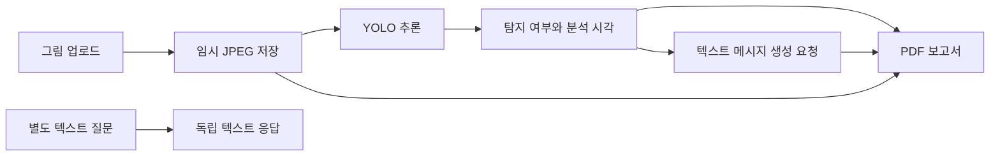

<div align="center">

# 🎨 기본 구성 · 그림 분석에서 대화와 PDF까지

**그림의 객체 탐지 여부를 대화형 메시지와 PDF 리포트로 연결하는 Python 프로토타입입니다.**

컴퓨터 비전·자연어 처리 › YOLO 객체 탐지 › Gradio 입력·텍스트 생성·FPDF 보고서

`Python` · `Ultralytics YOLO` · `Gradio` · `OpenAI API` · `OpenCV` · `FPDF`

[🎯 하는 일](#purpose) · [🔄 처리 흐름](#flow) · [📁 구성](#files) · [🚀 사용법](#usage) · [📊 결과 읽기](#results) · [🛠️ 제약과 문제 해결](#limits)

[🏠 프로젝트](../../README.md) · [🗂️ 전체 자료 안내](../REVISION_INDEX.md) · [🔎 구성과 변경 기록](../VERSIONS.md)

</div>

<a name="purpose"></a>

## 🎯 이 구성에서 하는 일

그림 한 장을 업로드하면 YOLO가 객체를 찾았는지 확인하고, 그 여부와 분석 시각을 텍스트로 정리합니다. `app.py`는 이 요약을 바탕으로 GPT-4o-mini에 공감 어린 질문·코멘트를 요청한 뒤 입력 그림과 함께 PDF로 저장합니다. 결과 화면에는 입력 그림, 생성 메시지, PDF 다운로드가 표시됩니다.

오른쪽 텍스트 질문 영역은 그림 분석과 별도의 요청입니다. `ask_gpt()`는 사용자가 입력한 질문 한 건을 보내며, 앞선 그림 분석이나 이전 대화 이력을 자동으로 덧붙이지 않습니다. 객체의 상세 위치·개수·심리적 의미까지 언어 모델이 직접 읽는 구성으로 설명하지 않습니다.

기본 앱, 데이터 생성, YOLO 학습, 텍스트 학습 자료 준비와 API 진입점을 한 묶음으로 읽는 구성입니다. 그림 분석 앱과 데이터를 만들고 학습을 요청하는 보조 코드는 각각 별도의 경로로 실행합니다.

## ✨ 주요 기능

| 기능 | 실제 처리 | 확인할 파일 |
|---|---|---|
| 그림 분석 | RGB 입력을 BGR로 바꾸어 임시 JPEG로 저장하고 YOLO 추론 | [app.py](../../app.py)의 `analyze_and_suggest()` |
| 탐지 요약 | 첫 추론 결과의 검출 상자가 있는지 확인해 성공·실패와 시각 기록 | [app.py](../../app.py)의 `has_det`, `analysis_summary` |
| 메시지 생성 | 탐지 여부 요약을 텍스트 요청으로 보내 10~15문장 코멘트 요청 | [app.py](../../app.py)의 `client.chat.completions.create()` |
| PDF 보고서 | 요약·생성 메시지·입력 그림을 A4 보고서에 배치 | [app.py](../../app.py)의 `build_pdf()` |
| 별도 질문 | 질문 한 건을 독립된 텍스트 요청으로 전달 | [app.py](../../app.py)의 `ask_gpt()` |
| HTTP 진입점 | `/gpt` POST의 `message`를 모델 요청에 전달 | [fastAPI.py](../../fastAPI.py) |
| 학습 보조 | 도형 이미지·YOLO 라벨 생성, 학습 및 JSONL·미세조정 요청 준비 | 아래 [학습 경로](#training) |

<a name="flow"></a>

## 🔄 입력 → 처리 → 출력



| 입력 | 처리 | 출력과 의미 |
|---|---|---|
| Gradio에 업로드한 그림 | `conf=0.05`, `imgsz=640`으로 YOLO 실행 | 객체 탐지 상자가 하나 이상 있는지에 대한 요약 |
| 탐지 여부·분석 시각 | `gpt-4o-mini`에 텍스트 요청 | 생성형 모델의 상담형 메시지이며 검증된 심리 판정이 아님 |
| 요약·메시지·입력 그림 | FPDF로 문서 작성 | `result/report.pdf` |
| 텍스트 질문 한 건 | 별도의 API 요청 | 해당 질문에 대한 응답 |

언어 모델로 전달하는 그림 분석 입력은 탐지 성공·실패를 요약한 텍스트입니다. 이 경로는 그림 바이트나 검출 상자의 상세 좌표를 모델에 보내는 멀티모달 요청이 아닙니다. 결과 이미지에도 검출 상자를 새로 그리지 않고 입력 RGB 그림을 그대로 반환합니다.

<a name="files"></a>

## 📁 실제 폴더와 모듈

```text
.
├── app.py                         # Gradio 그림·질문·PDF
├── fastAPI.py                     # /gpt 텍스트 요청
├── config.py                      # 환경변수 기반 설정
├── synthetic_drawings_generator.py
├── yolo_single_object_dataset.py
├── train_yolo_pipeline.py
├── train_yolo_dataset.py
├── train_result_check.py
├── finetune_samples.py
├── csv_to_jsonl.py
├── fine_tuning.py
├── build_and_finetune.py
└── list_finetuning_jops.py
```

위 목록은 저장소의 실행·보조 코드입니다. 아래 경로는 앱·학습 코드가 실행할 때 사용하는 입력·출력 위치이므로, 코드가 있다는 사실과 모델·데이터가 준비됐다는 사실을 구분합니다.

| 실행 시 필요한 위치 | 용도 |
|---|---|
| `input/` | 업로드 그림을 `temp.jpg`로 저장할 폴더. 앱에서 이 폴더를 자동 생성하지 않으므로 미리 준비 |
| `result/` | 앱이 생성하는 보고서 폴더 |
| `drawing_yolo_run/v8_finetune/weights/last.pt` | 기본 앱이 읽는 YOLO 가중치 |
| `yolo_single_object_dataset/` | 별도 YOLO 학습 루프가 읽는 학습 자료 |
| `generated/` | 12개 패치와 예시 라벨을 생성하는 다른 학습 경로 |

## ⚙️ 환경과 설정

기본 앱에는 Python과 `gradio`, `ultralytics`, `opencv-python`, `fpdf2`, `openai`가 필요합니다. 모델 가중치와 한글 폰트도 별도로 준비합니다. 앱과 API·미세조정 보조 코드의 SDK 호출 방식을 구분해 실행 환경을 준비합니다.

| 설정 | 기본 앱에서 읽는 값 | 조정할 곳 |
|---|---|---|
| API 인증 | 프로세스의 `OPENAI_API_KEY` | 본인 실행 환경 |
| YOLO 가중치 | `./drawing_yolo_run/v8_finetune/weights/last.pt` | `app.py`의 `YOLO_MODEL_PATH` |
| 작업 폴더 | `./` | `app.py`의 `PROJECT_DIR` |
| 임시 그림·보고서 | `input/temp.jpg`, `result/report.pdf` | `TEMP_IMG_PATH`, `PDF_OUTPUT_PATH` |
| PDF 글꼴 | Windows 맑은고딕 파일 경로 | `app.py`의 `FONT_PATH` |

`config.py`에는 `OPENAI_API_KEY`, `YOLO_MODEL_PATH`, `PDF_OUTPUT_PATH` 환경변수가 정의돼 있지만 기본 앱은 이 모듈을 가져오지 않고 자체 경로를 사용합니다. 환경변수 이름만 설정한 뒤 앱의 가중치·출력 경로도 바뀌었다고 생각하지 않도록 진입점의 값을 확인합니다.

<a name="usage"></a>

## 🚀 실행과 사용 방법

저장소 최상위 폴더에서 별도 Python 환경을 준비합니다.

```powershell
python -m venv .venv
.\.venv\Scripts\python -m pip install gradio ultralytics opencv-python fpdf2 openai
```

1. 본인 환경에 `OPENAI_API_KEY`를 설정합니다. 인증값을 코드나 공개 노트북에 쓰지 않습니다.
2. 가중치와 폰트의 실제 위치를 확인해 `app.py`의 경로를 맞춥니다.
3. `input/` 폴더를 준비하고 임시 그림과 보고서를 저장할 수 있는지 확인합니다.
4. 앱을 실행하고 표시된 Gradio 주소를 엽니다.

```powershell
.\.venv\Scripts\python app.py
```

5. 왼쪽에서 그림을 올리고 **분석 및 상담 메시지 생성**을 누릅니다. 입력 그림·텍스트 메시지·PDF 파일을 함께 확인합니다.
6. 오른쪽 **상담하기**는 별도 질문입니다. 이전 질문을 이어 쓰려면 필요한 문맥을 직접 입력해야 합니다.

`fastAPI.py`의 `/gpt`는 기본 Gradio 앱과 별도 진입점이며 코드의 SDK 호출 방식과 모델 이름도 다릅니다. 서버를 운영하거나 미세조정 요청을 제출하기 전 해당 파일의 패키지 호환성과 서비스 접근 권한을 확인합니다.

<a name="training"></a>

## 🧠 함께 보관한 학습 경로

| 경로 | 입력·처리·출력 | 해석할 때 주의할 점 |
|---|---|---|
| [복합 그림 생성](../../synthetic_drawings_generator.py) | 33종 도형을 조합해 640 크기 이미지와 YOLO 라벨을 작성. 학습·검증 각각 50,000장이 목표 설정 | 코드의 생성 목표이며 확보된 데이터 장수나 완료 기록을 뜻하지 않음 |
| [단일 객체 생성](../../yolo_single_object_dataset.py) | 클래스별 단일 객체를 학습·검증 각각 10,000장씩 생성하도록 구성 | 33개 클래스의 이름·색상·배치 규칙은 생성 코드에서 확인 |
| [12개 패치 예시](../../train_yolo_pipeline.py) | 한 그림을 3×4로 나누고 문·지붕·나무의 고정 예시 상자 라벨을 생성. 30 epoch·640·batch 8 설정 | 실제 객체를 자동 주석한 정답이 아니며 train과 val에 같은 이미지 폴더를 지정 |
| [별도 학습 루프](../../train_yolo_dataset.py) | 이미지 512·batch16, 50 epoch 단위 목표값을 30회 설정 | 검증 폴더가 없으면 학습 폴더를 복사. `resume_flag`는 계산하지만 학습 호출에 전달하지 않음 |
| [단일 그림 추론](../../train_result_check.py) | 지정한 가중치와 입력 한 장을 `conf=0.25`로 추론 | 앱의 0.05 임계값과 다르며 전체 시험 자료 성능이 아님 |

텍스트 학습 보조는 [예시 문장 CSV 생성](../../finetune_samples.py) → [기존 prompt/completion JSONL 변환](../../csv_to_jsonl.py) 또는 [대화형 JSONL·CLI 요청](../../build_and_finetune.py)으로 나뉩니다. [fine_tuning.py](../../fine_tuning.py)는 파일 업로드와 미세조정 작업 생성을 요청하고, [list_finetuning_jops.py](../../list_finetuning_jops.py)는 작업 목록을 조회합니다. 예시 문장 10개는 실제 상담 응답 데이터가 아니며, 이 파일들을 열거나 확인하는 것과 유료 외부 요청을 실행하는 것은 다릅니다. SDK·CLI 호출 세대가 다른 보조 코드를 한꺼번에 실행하지 않습니다.

<a name="results"></a>

## 📊 결과 읽기

**탐지 성공**은 검출 상자가 한 개 이상 있다는 뜻입니다. 그림 전체를 올바르게 이해했다거나, 객체의 의미를 임상적으로 판정했다는 뜻은 아닙니다. 낮은 신뢰도 임계값에서 얻은 검출 여부를 사용자에게 어떻게 설명할지 별도 평가가 필요합니다.

메시지는 탐지 요약을 입력으로 생성한 텍스트입니다. PDF에 그럴듯한 설명이 담겨도 심리 상태·진단·치료 효과의 검증 자료가 되지는 않습니다. 학습 코드의 검증 경로도 학습 자료를 재사용하는 구성이 있으므로 표시된 학습 지표를 독립 시험 정확도로 옮겨 쓰지 않습니다.

기본 앱을 사용할 때는 모델 가중치·입력 그림·한글 폰트를 준비합니다. 데이터 생성·학습 도구의 입력과 출력은 앱 경로와 별도로 맞춥니다. 관련 논문과 평가 노트북은 [미술치료 대화 프로젝트](https://github.com/PUVKID/Art-Therapy-Dialogue-Project)에서 구분해 확인할 수 있습니다.

<a name="limits"></a>

## 🛠️ 알려진 제약과 문제 해결

| 증상·제약 | 원인과 확인할 지점 |
|---|---|
| 시작할 때 API 키 오류 | 모듈 초기화 때 `OPENAI_API_KEY`를 읽습니다. 실행 프로세스의 환경을 확인 |
| 가중치 로드 오류 | 앱에 지정한 `last.pt`의 존재와 YOLO 모델 호환성 확인 |
| 그림 저장 실패 | `input/` 폴더와 쓰기 권한 확인. 업로드 그림이 없는 호출도 따로 처리하지 않음 |
| PDF 글꼴 오류 | 실제 한글 폰트 파일과 FPDF 패키지 구성을 확인 |
| 메시지가 API 오류 문구임 | 예외가 메시지 문자열로 반환되며 그대로 PDF에 들어갈 수 있음. 정상 생성 결과와 구분 |
| 이전 그림·PDF가 바뀜 | 임시 그림과 PDF가 고정 파일명입니다. 필요한 결과는 다음 실행 전에 별도 보관 |
| 여러 사용자의 결과가 섞일 수 있음 | 요청별 파일명·저장공간·동시성 분리가 없는 기본 프로토타입 |
| 이전 대화나 그림이 질문에 반영되지 않음 | `ask_gpt()`는 입력 질문 한 건을 독립 요청으로 전달 |
| 학습이 이어진다고 표시되지만 재개가 불명확함 | `resume_flag`의 계산과 실제 `model.train()` 인자가 연결돼 있지 않음 |

## 🔎 구성과 변경 기록

기본 앱과 데이터 생성·학습 보조 도구를 함께 읽는 Python 구성입니다. [전체 구성 설명](../VERSIONS.md)과 [변경 기록](../../CHANGELOG.md)에서 파일별 역할과 변화 내용을 확인할 수 있습니다.


---

[🏠 프로젝트 첫 화면](../../README.md) · [🗂️ 전체 자료 안내](../REVISION_INDEX.md) · [📚 구성 기록](../VERSIONS.md)


[📋 전체 구성과 변경 기록](../VERSIONS.md)
