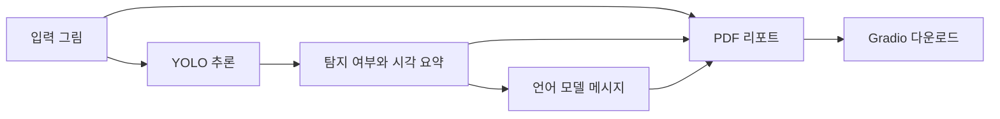
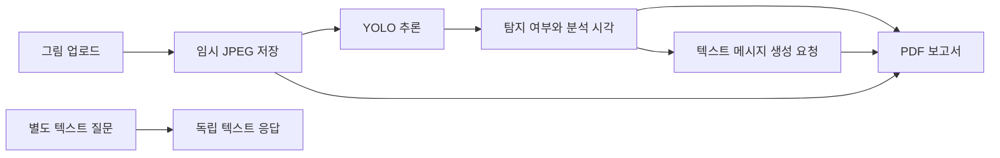

# Drawing-Analysis-Project — LEVEL 4 - Advanced

**읽기 수준 선택** · [LEVEL 1 - Beginner](%EB%A0%88%EB%B2%A81.md) · [LEVEL 2 - Explorer](%EB%A0%88%EB%B2%A82.md) · [LEVEL 3 - Practitioner](%EB%A0%88%EB%B2%A83.md) · **LEVEL 4 - Advanced** · [LEVEL 5 - Expert](%EB%A0%88%EB%B2%A85.md)

[같은 수준 프로필](https://github.com/PUVKID/PUVKID/blob/main/docs/읽기안내/레벨4.md) · [저장소 첫 화면](../../README.md)

<a id="guide-intro"></a>

## 프로젝트 소개

**시각 모델과 언어 모델을 텍스트 요약으로 연결합니다.** 입력 그림의 픽셀을 언어 모델에 보내는 멀티모달 구성과 다릅니다. 두 요청의 문맥 독립성과 고정 출력 경로가 동작 해석의 주요 경계입니다.

| 항목 | 핵심 내용 |
| --- | --- |
| 기능 | 텍스트 요약 인터페이스는 시각 정보의 손실을 수반합니다. 성공·실패만 넘기므로 객체의 세부 위치·개수·공간 관계를 언어 모델이 직접 아는 구조가 아닙니다. 출력 메시지의 표현 범위는 이 입력 제약을 따라야 합니다. |
| 입력·처리 | 시각 처리의 결과는 탐지 여부와 시각의 문자열 인터페이스로 축약됩니다. PDF 생성은 이 요약과 생성 텍스트·입력 그림을 합치는 후처리입니다. 모델의 실제 입력과 보고서에 보이는 자료가 서로 다릅니다. |
| 실행 | 실행 경계는 가중치·입력 폴더·폰트·API 설정과 파일 저장입니다. 요청별 경로 분리가 충분한지, 예외 문자열이 정상 메시지처럼 후처리에 전달되는지 확인합니다. 이 문서 작업 자체에서 외부 요청이나 학습을 실행한 것은 아닙니다. |
| 결과 | 결과물의 완결성과 추론의 타당성을 분리합니다. 그림·메시지·PDF가 생성돼도 시각 의미를 직접 읽었거나 임상 효과를 검증한 것은 아닙니다. 학습 자료 재사용 지표는 독립 일반화의 대체가 되지 않습니다. |
| 구현 | 화면 콜백과 학습 보조 경로가 한 저장소에 공존합니다. 런타임 앱에 필요한 의존성과 미세조정 도구의 호출 규약을 분리해야 합니다. 고정 파일명과 예외의 후처리 전달은 동시성과 오류 표현의 검토 지점입니다. |

<a id="guide-problem"></a>

## 문제와 주요 기능

텍스트 요약 인터페이스는 시각 정보의 손실을 수반합니다. 성공·실패만 넘기므로 객체의 세부 위치·개수·공간 관계를 언어 모델이 직접 아는 구조가 아닙니다. 출력 메시지의 표현 범위는 이 입력 제약을 따라야 합니다.

<a id="guide-flow"></a>

## 입력·처리·출력

시각 처리의 결과는 탐지 여부와 시각의 문자열 인터페이스로 축약됩니다. PDF 생성은 이 요약과 생성 텍스트·입력 그림을 합치는 후처리입니다. 모델의 실제 입력과 보고서에 보이는 자료가 서로 다릅니다.

<a id="guide-practice"></a>

## 실험과 사용 흐름

실행 경계는 가중치·입력 폴더·폰트·API 설정과 파일 저장입니다. 요청별 경로 분리가 충분한지, 예외 문자열이 정상 메시지처럼 후처리에 전달되는지 확인합니다. 이 문서 작업 자체에서 외부 요청이나 학습을 실행한 것은 아닙니다.

<a id="guide-results"></a>

## 관측 결과와 해석

결과물의 완결성과 추론의 타당성을 분리합니다. 그림·메시지·PDF가 생성돼도 시각 의미를 직접 읽었거나 임상 효과를 검증한 것은 아닙니다. 학습 자료 재사용 지표는 독립 일반화의 대체가 되지 않습니다.

<a id="guide-architecture"></a>

## 구현과 핵심 파일

화면 콜백과 학습 보조 경로가 한 저장소에 공존합니다. 런타임 앱에 필요한 의존성과 미세조정 도구의 호출 규약을 분리해야 합니다. 고정 파일명과 예외의 후처리 전달은 동시성과 오류 표현의 검토 지점입니다.

<a id="guide-paper"></a>

## 실제 논문과 원고

실행 구현과 연구 문헌의 관계는 대응 근거가 있을 때만 설명합니다. 별도 원고의 통합 상담 설계와 이 앱의 두 독립 호출을 같은 것으로 만들지 않습니다. 코드에 없는 멀티모달 경로를 논문 표현만으로 추가하지 않습니다.

<a id="guide-limits"></a>

## 조건·실패·미검증 한계

문맥 손실·동시 저장 충돌·외부 의존성·평가 누수가 설계 검토 지점입니다. 고정 이름과 비분리 요청은 기능 범위의 제한이며, 이를 숨기고 다중 사용자 상담 시스템으로 설명하지 않습니다.

## 전체 차수

차수는 아래의 실제 자료 구분을 따릅니다. 설명은 현재 선택한 수준으로 열리며, 자료 폴더와 당시 전체 비교도 함께 확인할 수 있습니다.

| 차수·단계 | 자료 |
| --- | --- |
| 기본 | **같은 수준 설명** [LEVEL 4 - Advanced](../versions/stage-1.md#reading-level-4)<br>**자료 폴더** [자료](..)<br>**직전 비교·구성** [전체 비교](../VERSIONS.md) |

## 첫 화면의 모든 설명과 공통 근거

아래는 기존 첫 화면의 실질 구성 전체입니다. 각 항목의 개념은 이 페이지의 풀이와 연결하고, 실제 표·코드·그림·상세 조건은 원문 공통 근거에서 확인합니다. 기존 전체 비교는 문장·주석·파일 단위의 작은 변화까지 보존하는 자료입니다.

| 첫 화면 구성 | 이 수준의 풀이 | 원문 공통 근거 |
| --- | --- | --- |
| 구현 요약 | [프로젝트 소개](#guide-intro) | [전체 설명·표·그림](../../README.md#-%EC%A3%BC%EC%9A%94-%EA%B0%9C%EB%B0%9C-%EB%82%B4%EC%9A%A9) |
| 입력·처리·출력 | [기본 앱에서 실제로 전달되는 정보](#semantic-appflow-level-4) | [전체 설명·표·그림](../../README.md#-%EC%9E%85%EB%A0%A5%EC%B2%98%EB%A6%AC%EC%B6%9C%EB%A0%A5) |
| 전체 차수 | [문제와 주요 기능](#guide-problem) | [전체 설명·표·그림](../../README.md#%EF%B8%8F-%EC%B0%A8%EC%88%98%EB%B3%84-%ED%94%84%EB%A1%9C%EC%A0%9D%ED%8A%B8-%EC%95%88%EB%82%B4) |
| 연구 방법 | [기본 앱에서 실제로 전달되는 정보](#semantic-appflow-level-4) | [전체 설명·표·그림](../../README.md#-%ED%94%84%EB%A1%9C%EC%A0%9D%ED%8A%B8-%EC%86%8C%EA%B0%9C) |
| 저장소 구성 | [구현과 핵심 파일](#guide-architecture) | [전체 설명·표·그림](../../README.md#-%EC%A0%80%EC%9E%A5%EC%86%8C-%EA%B5%AC%EC%84%B1) |
| 주요 기술과 처리 흐름 | [기본 앱에서 실제로 전달되는 정보](#semantic-appflow-level-4) | [전체 설명·표·그림](../../README.md#-%EC%A3%BC%EC%9A%94-%EA%B8%B0%EC%88%A0%EA%B3%BC-%EC%B2%98%EB%A6%AC-%ED%9D%90%EB%A6%84) |
| 빠른 시작 | [실행 경로와 준비물](#semantic-setup-level-4) | [전체 설명·표·그림](../../README.md#-%EB%B9%A0%EB%A5%B8-%EC%8B%9C%EC%9E%91) |
| 데이터 구성과 실험 설정 | [그림 생성 목표와 YOLO 학습의 한계](#semantic-training-level-4) | [전체 설명·표·그림](../../README.md#-%EB%8D%B0%EC%9D%B4%ED%84%B0-%EA%B5%AC%EC%84%B1%EA%B3%BC-%EC%8B%A4%ED%97%98-%EC%84%A4%EC%A0%95) |
| 문제 해결 | [증상별 확인점과 결과의 경계](#semantic-failures-level-4) | [전체 설명·표·그림](../../README.md#%EF%B8%8F-%EB%AC%B8%EC%A0%9C-%ED%95%B4%EA%B2%B0) |
| 실행 경로 | [실행 경로와 준비물](#semantic-setup-level-4) | [전체 설명·표·그림](../../README.md#-%EC%8B%A4%ED%96%89-%EA%B2%BD%EB%A1%9C) |
| 자료 폴더와 차수별 변화 | [문제와 주요 기능](#guide-problem) | [전체 설명·표·그림](../../README.md#%EF%B8%8F-%EC%9E%90%EB%A3%8C-%ED%8F%B4%EB%8D%94%EC%99%80-%EC%B0%A8%EC%88%98%EB%B3%84-%EB%B3%80%ED%99%94) |
| 기본 앱과 학습 보조의 세부 구성 | [구현과 핵심 파일](#guide-architecture) | [전체 설명·표·그림](../../README.md#-%EA%B8%B0%EB%B3%B8-%EC%95%B1%EA%B3%BC-%ED%95%99%EC%8A%B5-%EB%B3%B4%EC%A1%B0%EC%9D%98-%EC%84%B8%EB%B6%80-%EA%B5%AC%EC%84%B1) |
| 구현 목적 | [기본 앱에서 실제로 전달되는 정보](#semantic-appflow-level-4) | [전체 설명·표·그림](../../README.md#-%EC%9D%B4-%EA%B5%AC%EC%84%B1%EC%97%90%EC%84%9C-%ED%95%98%EB%8A%94-%EC%9D%BC) |
| 기능 | [기본 앱에서 실제로 전달되는 정보](#semantic-appflow-level-4) | [전체 설명·표·그림](../../README.md#-%EC%A3%BC%EC%9A%94-%EA%B8%B0%EB%8A%A5) |
| 입력·처리·출력 | [기본 앱에서 실제로 전달되는 정보](#semantic-appflow-level-4) | [전체 설명·표·그림](../../README.md#-%EC%9E%85%EB%A0%A5--%EC%B2%98%EB%A6%AC--%EC%B6%9C%EB%A0%A5) |
| 실제 폴더와 모듈 | [실행 경로와 준비물](#semantic-setup-level-4) | [전체 설명·표·그림](../../README.md#-%EC%8B%A4%EC%A0%9C-%ED%8F%B4%EB%8D%94%EC%99%80-%EB%AA%A8%EB%93%88) |
| 실행 환경과 설정 | [실행 경로와 준비물](#semantic-setup-level-4) | [전체 설명·표·그림](../../README.md#%EF%B8%8F-%ED%99%98%EA%B2%BD%EA%B3%BC-%EC%84%A4%EC%A0%95) |
| 실행과 사용 방법 | [기본 앱에서 실제로 전달되는 정보](#semantic-appflow-level-4) | [전체 설명·표·그림](../../README.md#-%EC%8B%A4%ED%96%89%EA%B3%BC-%EC%82%AC%EC%9A%A9-%EB%B0%A9%EB%B2%95) |
| 함께 보관한 학습 경로 | [텍스트 학습 보조와 외부 요청](#semantic-finetuning-level-4) | [전체 설명·표·그림](../../README.md#-%ED%95%A8%EA%BB%98-%EB%B3%B4%EA%B4%80%ED%95%9C-%ED%95%99%EC%8A%B5-%EA%B2%BD%EB%A1%9C-1) |
| 결과 읽기 | [기본 앱에서 실제로 전달되는 정보](#semantic-appflow-level-4) | [전체 설명·표·그림](../../README.md#-%EA%B2%B0%EA%B3%BC-%EC%9D%BD%EA%B8%B0) |
| 제약과 문제 해결 | [증상별 확인점과 결과의 경계](#semantic-failures-level-4) | [전체 설명·표·그림](../../README.md#%EF%B8%8F-%EC%95%8C%EB%A0%A4%EC%A7%84-%EC%A0%9C%EC%95%BD%EA%B3%BC-%EB%AC%B8%EC%A0%9C-%ED%95%B4%EA%B2%B0) |
| 구성과 변경 기록 | [구현과 핵심 파일](#guide-architecture) | [전체 설명·표·그림](../../README.md#-%EA%B5%AC%EC%84%B1%EA%B3%BC-%EB%B3%80%EA%B2%BD-%EA%B8%B0%EB%A1%9D) |

## 이어 읽기

같은 난이도로 다른 프로젝트를 찾으려면 [프로필의 LEVEL 4 - Advanced](https://github.com/PUVKID/PUVKID/blob/main/docs/읽기안내/레벨4.md)를 엽니다. 이 저장소 안에서는 위 전체 차수 표의 같은 수준 설명으로 이동하세요. 단계별 선택표에서 깊이를 바꿀 수 있으며, LEVEL 5 아래에는 기존 상세 전체가 보존되어 있습니다.

<!-- semantic-explanation17:start -->

## LEVEL 4 · 조건과 절차를 상세히 읽기

<a id="semantic-appflow-level-4"></a>

### LEVEL 4 · 기본 앱에서 실제로 전달되는 정보

분석 경계는 YOLO 상자의 존재를 불리언 요약으로 축약하는 곳입니다. 상세 위치와 이미지 정보는 언어 모델로 전파되지 않습니다. 별도 HTTP 경로와 Gradio 경로의 SDK·모델을 하나의 호출 계약으로 취급하면 설정 오류를 만들 수 있습니다.

<a id="layout18-table-3-row-1"></a>

**그림 입력과 추론**

**조건·자료**

그림 입력과 추론

**의미와 확인 방법**

app.py는 RGB 그림을 BGR 임시 JPEG로 저장하고 YOLO를 conf=0.05·imgsz640으로 실행합니다. 검출 상자 한 개 이상이면 탐지 성공으로 요약합니다.

<a id="layout18-table-3-row-2"></a>

**언어 모델 요청**

**조건·자료**

언어 모델 요청

**의미와 확인 방법**

gpt-4o-mini에 보내는 것은 탐지 성공/실패와 분석 시각의 텍스트입니다. 그림 바이트·객체 좌표를 보내는 멀티모달 요청이 아니며 10~15문장 코멘트를 요청합니다.

<a id="layout18-table-3-row-3"></a>

**화면과 PDF**

**조건·자료**

화면과 PDF

**의미와 확인 방법**

결과 RGB 그림은 입력 그림을 돌려준 것이며 검출 상자를 새로 그리지 않습니다. FPDF가 시각·요약·메시지·입력 그림을 A4 PDF로 묶습니다.

<a id="layout18-table-3-row-4"></a>

**별도 질문과 API**

**조건·자료**

별도 질문과 API

**의미와 확인 방법**

오른쪽 ask_gpt는 질문 한 건만 보내며 이전 대화·그림 분석을 자동 포함하지 않습니다. fastAPI.py의 /gpt POST는 별도 진입점으로 SDK 방식·모델 이름도 별도로 확인합니다.

<a id="layout18-table-3-row-5"></a>

**단일 그림 검사**

**조건·자료**

단일 그림 검사

**의미와 확인 방법**

train_result_check.py의 conf=0.25는 기본 앱의 0.05와 다릅니다. 한 장의 추론 결과를 전체 시험 성능이나 심리 이해 성공으로 바꾸지 않습니다.


<a id="semantic-setup-level-4"></a>

### LEVEL 4 · 실행 경로와 준비물

모듈 초기화 인증과 상대 경로 해석은 실행 cwd에 영향을 받습니다. config의 정의와 실제 import 경로를 구분하고 기본 Gradio와 별도 API 진입점의 의존성을 따로 확인해야 합니다. 사용자별 저장 분리는 현재 구성에 없습니다.

<a id="layout18-table-4-row-1"></a>

**저장소 루트에서 실행**

**조건·자료**

저장소 루트에서 실행

**의미와 확인 방법**

Python 환경과 gradio·ultralytics·opencv-python·fpdf2·openai를 준비합니다. 실행 프로세스가 OPENAI_API_KEY를 읽을 수 있어야 합니다.

<a id="layout18-table-4-row-2"></a>

**가중치·작업·폰트**

**조건·자료**

가중치·작업·폰트

**의미와 확인 방법**

app.py의 YOLO_MODEL_PATH·PROJECT_DIR·FONT_PATH를 실제 경로로 맞춥니다. 기본 가중치 위치는 drawing_yolo_run/v8_finetune/weights/last.pt이며 한글 폰트가 별도로 필요합니다.

<a id="layout18-table-4-row-3"></a>

**입력 수동·출력 자동**

**조건·자료**

입력 수동·출력 자동

**의미와 확인 방법**

input/은 먼저 준비해야 합니다. 업로드는 input/temp.jpg에 저장하고 result/는 코드가 생성해 result/report.pdf를 씁니다. 폴더 존재와 쓰기 권한을 확인합니다.

<a id="layout18-table-4-row-4"></a>

**config.py와 앱 설정**

**조건·자료**

config.py와 앱 설정

**의미와 확인 방법**

config.py에 환경변수 설정이 있어도 기본 app.py는 그 모듈을 가져오지 않고 자체 경로를 씁니다. 환경변수 이름만 바꾸면 모든 앱 경로가 바뀐다고 생각하지 않습니다.

<a id="layout18-table-4-row-5"></a>

**실행과 결과 보관**

**조건·자료**

실행과 결과 보관

**의미와 확인 방법**

원문의 가상환경 준비·app.py 실행 명령을 저장소 루트에서 사용합니다. Gradio 주소를 연 뒤 결과를 확인하고 필요한 그림/PDF는 다음 실행 전에 별도로 보관합니다.


<a id="semantic-training-level-4"></a>

### LEVEL 4 · 그림 생성 목표와 YOLO 학습의 한계

고정 라벨은 실제 객체 주석 파이프라인을 대신하지 못하며 학습폴더 복사는 검증 누수를 만들 수 있습니다. 재개 여부는 계산된 변수보다 model.train 호출 인자에서 결정되므로, 현재의 resume 연결 공백을 유지해 설명합니다.

<a id="layout18-table-5-row-1"></a>

**12패치 예시 학습**

**조건·자료**

12패치 예시 학습

**의미와 확인 방법**

그림을3×4로 나누고 door·roof·tree의 고정 예시 상자를 붙입니다.30epoch·640·batch8이며 train/val에 같은 이미지 폴더를 지정합니다. 실제 객체를 자동 주석한 독립 정답이 아닙니다.

<a id="layout18-table-5-row-2"></a>

**33종 복합·단일 도형 생성**

**조건·자료**

33종 복합·단일 도형 생성

**의미와 확인 방법**

복합 그림은 학습/검증 각각50,000장,단일 객체는33클래스별 학습/검증 각각10,000장 생성이 코드 목표입니다. 이미 확보·생성·학습 완료한 장수가 아닙니다.

<a id="layout18-table-5-row-3"></a>

**별도 학습 루프**

**조건·자료**

별도 학습 루프

**의미와 확인 방법**

train_yolo_dataset.py는512·batch16·50epoch 단위 목표를30회 설정합니다. 검증폴더가 없으면 학습폴더를 복사하므로 독립 시험 분할이 아닙니다.

<a id="layout18-table-5-row-4"></a>

**재개 연결**

**조건·자료**

재개 연결

**의미와 확인 방법**

resume_flag를 계산해도 model.train() 인자로 전달하지 않습니다. 플래그가 있다는 사실만으로 이전 학습을 정상 재개한다고 판단할 수 없습니다.

<a id="layout18-table-5-row-5"></a>

**기본 앱과의 관계**

**조건·자료**

기본 앱과의 관계

**의미와 확인 방법**

그림 생성·패치 라벨·YOLO 학습은 별도 보조 경로입니다. 이미 준비한 가중치로 앱을 쓰는 데 이 모든 데이터를 새로 만들거나 외부 미세조정을 먼저 실행할 필요는 없습니다.


<a id="semantic-finetuning-level-4"></a>

### LEVEL 4 · 텍스트 학습 보조와 외부 요청

데이터 포맷과 서비스 호출 계약의 세대 차이가 주요 경계입니다. prompt/completion과 메시지형 데이터를 무조건 같은 CLI에 넣으면 안 됩니다. 앱 추론과 학습 작업의 인증·비용·실행 수명도 다릅니다.

<a id="layout18-table-6-row-1"></a>

**문장10개→CSV**

**조건·자료**

문장10개→CSV

**의미와 확인 방법**

finetune_samples.py는 코드에 직접 쓴 예시 문장10개를 CSV로 만듭니다. 실제 상담 응답 표본이나 검증된 심리 판정 기준이 아닙니다.

<a id="layout18-table-6-row-2"></a>

**서로 다른 JSONL 경로**

**조건·자료**

서로 다른 JSONL 경로

**의미와 확인 방법**

csv_to_jsonl.py는 기존 prompt/completion 형식, build_and_finetune.py는 대화형 JSONL과 기존 CLI의 데이터 준비·학습 명령을 사용합니다.

<a id="layout18-table-6-row-3"></a>

**작업 생성과 조회**

**조건·자료**

작업 생성과 조회

**의미와 확인 방법**

fine_tuning.py는 파일을 외부 API에 올려 미세조정 작업 생성을 요청하고 list_finetuning_jops.py는 작업 목록을 조회합니다. 코드를 읽는 일과 유료 외부 요청 실행은 다릅니다.

<a id="layout18-table-6-row-4"></a>

**SDK·CLI 호환성**

**조건·자료**

SDK·CLI 호환성

**의미와 확인 방법**

보조 코드의 호출 세대가 서로 다릅니다. 기본 앱과 분리해 보고, 현재 패키지/서비스 호환성과 계정 접근 권한 확인 없이 일괄 실행하지 않습니다.


<a id="semantic-failures-level-4"></a>

### LEVEL 4 · 증상별 확인점과 결과의 경계

예외를 문자열로 되돌리는 경로와 공유 파일명은 성공 신호 및 데이터 격리의 한계입니다. 업로드 부재 처리와 동시 요청 분리도 구현되지 않았습니다. 현재 보조 학습 경로의 재개와 평가 독립성까지 포함해 실패 경계를 분석해야 합니다.

<a id="layout18-table-7-row-1"></a>

**키·가중치·빈 탐지**

**조건·자료**

키·가중치·빈 탐지

**의미와 확인 방법**

시작 시 키 오류는 초기화하는 프로세스 환경,가중치 오류는 app.py의 last.pt 존재/호환성,빈 탐지는 그림·클래스·conf를 확인합니다. 낮은0.05에서 상자가 생겼다고 의미 이해가 검증되지는 않습니다.

<a id="layout18-table-7-row-2"></a>

**저장·폰트·업로드 누락**

**조건·자료**

저장·폰트·업로드 누락

**의미와 확인 방법**

입력 저장 실패는 input/과 쓰기 권한,한글 PDF는 실제 폰트와 FPDF 패키지를 확인합니다. 업로드 그림이 없는 호출을 따로 처리하는 방어는 없습니다.

<a id="layout18-table-7-row-3"></a>

**API 오류가 PDF에 포함될 수 있음**

**조건·자료**

API 오류가 PDF에 포함될 수 있음

**의미와 확인 방법**

예외가 메시지 문자열로 반환되어 그대로 보고서에 들어갈 수 있습니다. 정상 문장처럼 보이는 출력도 서비스 인증·연결·모델 접근 상태와 함께 확인합니다.

<a id="layout18-table-7-row-4"></a>

**공유 파일과 동시성**

**조건·자료**

공유 파일과 동시성

**의미와 확인 방법**

input/temp.jpg·result/report.pdf가 고정되어 이전 결과를 덮어씁니다. 요청별 이름·저장공간·사용자별 분리·동시성 제어가 없는 프로토타입입니다.

<a id="layout18-table-7-row-5"></a>

**평가 범위**

**조건·자료**

평가 범위

**의미와 확인 방법**

탐지 성공은 상자≥1,PDF는 생성 문서입니다. 그림 전체 이해·임상 진단·치료 효과·학습자료 재사용 검증의 독립 성능을 보장하지 않습니다.


<!-- semantic-explanation17:end -->

<!-- complete-source-facts17:start -->

## 첫 화면의 세부 사실을 빠짐없이 읽기

위의 수준별 풀이에 대응하는 실제 세부 사실입니다. 입력·조건·수치·표·그림·문서 판본과 작은 변경까지 같은 페이지에서 확인하도록 기존 첫 화면의 내용을 함께 수록했습니다. 각 절은 해당 수준의 앞선 설명과 연결해 읽으며, 원래 실행 코드·전체 비교·원고는 원문 주소로 이어집니다.

<a id="facts-section-0"></a>

### LEVEL 4 · 첫 화면 기본 정보


YOLO 탐지 결과를 GPT 대화와 그림 분석 PDF로 연결합니다.

분야: 컴퓨터 비전·자연어 처리 › 검출·언어 모델 연결 › 그림 탐지 요약→대화·PDF

`Python`
`YOLO`
`Gradio`

[빠른 시작](../../README.md#quick-start) · [저장소 구성](../../README.md#repository-structure) · [실험 설정](../../README.md#data-settings)

[핵심 구성](../../README.md#input-processing-output)


<a id="facts-section-1"></a>

### LEVEL 4 · 구현 요약


YOLO 그림 탐지, 텍스트 질문, PDF 기록을 연결하는 기본 앱입니다.

- analyze_and_suggest는 업로드 그림의 탐지 결과를 분석·제안 흐름으로 전달합니다.
- ask_gpt는 텍스트 대화, build_pdf는 대화 결과의 PDF 생성을 담당합니다.
- 학습용 자료 준비와 YOLO 학습은 별도 스크립트로 구성했습니다.

**자료별 안내:** [기본](../../docs/versions/stage-1.md#reading-level-4) · [전체 기록](../../docs/VERSIONS.md)


<a id="facts-section-2"></a>

### LEVEL 4 · 입력·처리·출력


| 구분 | 내용 |
| --- | --- |
| 문제 | 그림의 탐지 결과를 텍스트 대화와 보고서에 연결합니다. |
| 입력 | 그림 이미지·사용자 텍스트 |
| 처리 | YOLO 탐지 여부 요약을 GPT-4o-mini 텍스트 요청에 연결 |
| 출력 | 대화 메시지·입력 그림을 담은 PDF |

---


<a id="facts-section-3"></a>

### LEVEL 4 · 전체 차수


| 차수·단계 | 자료 |
| --- | --- |
| [기본](../../docs/versions/stage-1.md#reading-level-4) | **주요 내용** 그림 탐지·텍스트 대화·PDF와 데이터 생성·학습 보조를 연결한 기본 구성입니다.<br>**자료** [폴더](../../docs)<br>**직전 비교** [전체 비교](../../docs/VERSIONS.md) |


<a id="facts-section-4"></a>

### LEVEL 4 · 연구 방법


YOLO 추론, 언어 모델 메시지 생성, PDF 출력을 하나의 Gradio 화면에서 연결합니다. 별도 스크립트에는 그림 데이터 준비와 YOLO 학습, JSONL 변환 및 미세조정 작업이 담겨 있습니다.

| 기능 | 구현 내용 |
| --- | --- |
| 그림 입력 | Gradio 이미지 입력을 임시 이미지로 저장 |
| 객체 탐지 | 학습된 YOLO 가중치로 추론하고 탐지 유무 확인 |
| 메시지 생성 | 탐지 성공·실패 요약을 바탕으로 대화형 메시지 요청 |
| PDF 생성 | 분석 시각·요약·메시지·입력 그림을 리포트로 구성 |
| 데이터 준비 | 그림 생성, 패치 분할, 학습 라벨 구성 스크립트 |
| 학습 도구 | YOLO 학습과 JSONL·미세조정 보조 코드 |




<a id="facts-section-5"></a>

### LEVEL 4 · 저장소 구성


주요 파일 구성은 다음과 같습니다.

```text
.
├── app.py
├── fastAPI.py
├── config.py
├── synthetic_drawings_generator.py
├── yolo_single_object_dataset.py
├── train_yolo_dataset.py
├── train_yolo_pipeline.py
├── csv_to_jsonl.py
├── fine_tuning.py
├── build_and_finetune.py
└── docs/VERSIONS.md
```

- [Gradio 앱](../../app.py): 입력·추론·대화·PDF 연결.
- [YOLO 학습 파이프라인](../../train_yolo_pipeline.py): 이미지 분할과 예시 라벨·학습 구성.
- [그림 생성](../../synthetic_drawings_generator.py)과 [단일 객체 데이터 준비](../../yolo_single_object_dataset.py).
- [JSONL 변환](../../csv_to_jsonl.py), [미세조정 코드](../../fine_tuning.py), [버전 기록](../../docs/VERSIONS.md).


#### LEVEL 4 · 관련 연구와 공개 범위

[미술치료 대화 연구](https://github.com/PUVKID/Art-Therapy-Dialogue-Project)는 같은 YOLO 탐지 요약·대화·PDF 설계를 논문과 노트북으로 설명합니다. 이 저장소는 데이터 생성·학습·미세조정·API 진입점을 포함한 Python 코드 구성을 보존합니다. 그림 분석의 같은 흐름을 다루지만, 여기서는 Python 실행 파일과 학습 보조 도구를, 대화 연구 저장소에서는 최종 논문과 노트북을 살펴볼 수 있습니다.


<a id="facts-section-6"></a>

### LEVEL 4 · 주요 기술과 처리 흐름


`app.py`는 OpenCV로 입력을 저장하고 Ultralytics YOLO를 호출합니다. 추론 설정은 `conf=0.05`, `imgsz=640`입니다. 언어 모델에는 탐지 성공·실패와 분석 시각을 담은 텍스트 요약을 전달합니다. 이 경로에서 원본 그림 자체나 상세 객체 좌표가 언어 모델로 전달되는 것은 아닙니다.

`build_pdf()`는 FPDF로 메시지와 그림을 문서에 배치합니다. 결과 이미지에는 탐지 상자를 새로 그리지 않고 입력 그림을 그대로 돌려줍니다. `ask_gpt()`는 별도의 텍스트 질문 입력을 처리합니다. 모델 요청 이름은 코드에 지정된 `gpt-4o-mini`이며 실제 서비스 접근 가능 여부는 실행 환경에 따라 확인해야 합니다.


<a id="facts-section-7"></a>

### LEVEL 4 · 빠른 시작


저장소 루트에서 Python 환경을 준비합니다.

```powershell
python -m venv .venv
.\.venv\Scripts\python -m pip install gradio ultralytics fpdf2 openai opencv-python
```

1. 본인 환경에 `OPENAI_API_KEY`를 설정합니다.
2. `app.py`의 `YOLO_MODEL_PATH`, `PROJECT_DIR`, `FONT_PATH`를 실제 모델·작업·폰트 경로에 맞춥니다.
3. `INPUT_DIR`에 해당하는 입력 폴더를 준비합니다. 출력 폴더는 코드에서 생성합니다.
4. 앱을 실행합니다.

```powershell
.\.venv\Scripts\python app.py
```

`config.py`의 환경변수와 `app.py`의 자체 경로 설정은 각각 관리합니다. 실행할 진입점에 모델 가중치·입력 그림·폰트 경로를 설정하고 서비스 인증정보를 준비합니다.


<a id="facts-section-8"></a>

### LEVEL 4 · 데이터 구성과 실험 설정


| 항목 | 확인할 내용 |
| --- | --- |
| 그림 입력 | 앱에 넣을 이미지와 읽기·저장 경로 |
| YOLO 가중치 | 해당 그림 객체로 학습된 모델 파일 |
| 리포트 | `result/report.pdf` 경로에 생성하도록 구성 |
| 예시 학습 클래스 | `train_yolo_pipeline.py`의 `door`, `roof`, `tree` |
| 예시 학습 설정 | 30 epochs, 이미지 640, batch 8 |

`train_yolo_pipeline.py`는 고정 위치의 예시 라벨을 생성하고 학습·검증에 같은 이미지 폴더를 지정합니다. 이 구성의 검증 수치는 학습 자료에 대한 적합도를 나타내며, 일반화 성능 평가에는 별도의 정답 라벨과 독립 시험 자료가 필요합니다.


#### LEVEL 4 · 함께 보관한 학습 경로

<a id="layout18-table-12-row-1"></a>

**`synthetic_drawings_generator.py`**

**파일**

`synthetic_drawings_generator.py`

**입력·출력과 설정**

33종 도형을 한 이미지에 조합하고, 학습·검증 각각 50,000장과 YOLO 라벨을 생성하도록 설정

<a id="layout18-table-12-row-2"></a>

**`yolo_single_object_dataset.py`**

**파일**

`yolo_single_object_dataset.py`

**입력·출력과 설정**

33개 클래스별로 단일 객체 이미지를 학습·검증 각각 10,000장씩 생성하도록 설정

<a id="layout18-table-12-row-3"></a>

**`train_yolo_dataset.py`**

**파일**

`train_yolo_dataset.py`

**입력·출력과 설정**

이미지 512, batch 16, 50 epoch 단위 목표값을 30회 설정하는 별도 학습 루프

<a id="layout18-table-12-row-4"></a>

**`finetune_samples.py`**

**파일**

`finetune_samples.py`

**입력·출력과 설정**

코드에 직접 작성된 문장 10개를 CSV로 저장

<a id="layout18-table-12-row-5"></a>

**`csv_to_jsonl.py`**

**파일**

`csv_to_jsonl.py`

**입력·출력과 설정**

CSV의 `prompt`·`completion`을 기존 형식 JSONL로 변환

<a id="layout18-table-12-row-6"></a>

**`fine_tuning.py`**

**파일**

`fine_tuning.py`

**입력·출력과 설정**

JSONL 파일을 외부 API에 올리고 미세조정 작업 생성

<a id="layout18-table-12-row-7"></a>

**`build_and_finetune.py`**

**파일**

`build_and_finetune.py`

**입력·출력과 설정**

대화형 JSONL 생성 후 기존 CLI의 데이터 준비·학습 명령 호출

<a id="layout18-table-12-row-8"></a>

**`list_finetuning_jops.py`**

**파일**

`list_finetuning_jops.py`

**입력·출력과 설정**

계정의 미세조정 작업 목록 조회

<a id="layout18-table-12-row-9"></a>

**`train_result_check.py`**

**파일**

`train_result_check.py`

**입력·출력과 설정**

지정된 가중치와 이미지 한 장으로 `conf=0.25` 추론

<a id="layout18-table-12-row-10"></a>

**`fastAPI.py`**

**파일**

`fastAPI.py`

**입력·출력과 설정**

`/gpt` POST 요청의 텍스트를 별도 모델 요청으로 전달


위 생성 장수는 **코드의 목표 설정**입니다. `train_yolo_dataset.py`는 검증 폴더가 없으면 학습 폴더를 복사하고, `resume_flag`를 계산하지만 `model.train()` 인자로 전달하지 않습니다. 학습 재개 연결은 보완이 필요한 부분입니다.

미세조정 파일들은 JSONL 형식과 SDK·CLI 호출 세대가 서로 다릅니다. 기본 앱 실행과 분리해 보관하며, 최신 서비스 호환성 확인 없이 일괄 실행하지 않습니다. 예시 문장도 실제 응답 자료나 검증된 심리 판정 기준이 아닙니다.

`ask_gpt()`는 입력한 질문 한 건을 보내며 이전 대화 이력이나 그림 분석 결과를 자동으로 이어 붙이지 않습니다. 입력 이미지와 PDF도 각각 `input/temp.jpg`, `result/report.pdf`라는 고정 파일명을 사용하므로, 여러 사용자의 자료를 분리 보관하는 서비스로 설계된 코드는 아닙니다. 필요한 결과는 다음 실행 전에 별도로 보관하세요.

생성 메시지는 연구용 프로토타입의 출력이며, 그림의 심리적 의미와 치료 효과는 별도 검증이 필요합니다.


<a id="facts-section-9"></a>

### LEVEL 4 · 문제 해결


| 증상 | 확인할 내용 |
| --- | --- |
| `OPENAI_API_KEY` 오류 | 실행 프로세스가 환경변수를 읽을 수 있는지 확인 |
| 가중치 파일 오류 | `app.py`에 직접 지정한 모델 경로 |
| 입력 저장 실패 | `INPUT_DIR` 폴더 존재와 쓰기 권한 |
| PDF 한글 오류 | 폰트 파일 경로와 FPDF 패키지 구성 |
| 탐지 결과가 비어 있음 | 입력·모델 클래스·신뢰도 설정을 함께 확인 |
| API 호출 오류 | 서비스 인증·연결·모델 접근 권한 |

---

그림 입력에서 리포트까지, 처리 단계를 연결하는 연구입니다.


<a id="facts-section-10"></a>

### LEVEL 4 · 실행 경로


저장소 최상위 폴더에서 실행합니다. 모델·입력·학습 자료의 경로는 해당 폴더를 기준으로 한 상대 경로이며, 필요한 모델과 데이터는 실행 전에 준비합니다.


<a id="facts-section-11"></a>

### LEVEL 4 · 자료 폴더와 차수별 변화


| 자료 | 자료 |
| --- | --- |
| 기본 | **자료 폴더** [자료 폴더](../../docs)<br>**설명** [내용](../../docs/versions/stage-1.md#reading-level-4)<br>**비교·구성** [비교·구성](../../docs/VERSIONS.md) |


<a id="facts-section-12"></a>

### LEVEL 4 · 기본 앱과 학습 보조의 세부 구성


<a id="facts-section-13"></a>

### LEVEL 4 · 구현 목적


그림 한 장을 업로드하면 YOLO가 객체를 찾았는지 확인하고, 그 여부와 분석 시각을 텍스트로 정리합니다. `app.py`는 이 요약을 바탕으로 GPT-4o-mini에 공감 어린 질문·코멘트를 요청한 뒤 입력 그림과 함께 PDF로 저장합니다.

결과 화면에는 입력 그림, 생성 메시지, PDF 다운로드가 표시됩니다.

오른쪽 텍스트 질문 영역은 그림 분석과 별도의 요청입니다. `ask_gpt()`는 사용자가 입력한 질문 한 건을 보내며, 앞선 그림 분석이나 이전 대화 이력을 자동으로 덧붙이지 않습니다.

객체의 상세 위치·개수·심리적 의미까지 언어 모델이 직접 읽는 구성으로 설명하지 않습니다.

기본 앱, 데이터 생성, YOLO 학습, 텍스트 학습 자료 준비와 API 진입점을 한 묶음으로 읽는 구성입니다. 그림 분석 앱과 데이터를 만들고 학습을 요청하는 보조 코드는 각각 별도의 경로로 실행합니다.


<a id="facts-section-14"></a>

### LEVEL 4 · 기능


| 기능 | 실제 처리 | 확인할 파일 |
| --- | --- | --- |
| 그림 분석 | RGB 입력을 BGR로 바꾸어 임시 JPEG로 저장하고 YOLO 추론 | [app.py](../../app.py)의 `analyze_and_suggest()` |
| 탐지 요약 | 첫 추론 결과의 검출 상자가 있는지 확인해 성공·실패와 시각 기록 | [app.py](../../app.py)의 `has_det`, `analysis_summary` |
| 메시지 생성 | 탐지 여부 요약을 텍스트 요청으로 보내 10~15문장 코멘트 요청 | [app.py](../../app.py)의 `client.chat.completions.create()` |
| PDF 보고서 | 요약·생성 메시지·입력 그림을 A4 보고서에 배치 | [app.py](../../app.py)의 `build_pdf()` |
| 별도 질문 | 질문 한 건을 독립된 텍스트 요청으로 전달 | [app.py](../../app.py)의 `ask_gpt()` |
| HTTP 진입점 | `/gpt` POST의 `message`를 모델 요청에 전달 | [fastAPI.py](../../fastAPI.py) |
| 학습 보조 | 도형 이미지·YOLO 라벨 생성, 학습 및 JSONL·미세조정 요청 준비 | 아래 [학습 경로](../../README.md#training) |


<a id="facts-section-15"></a>

### LEVEL 4 · 입력·처리·출력




| 입력 | 처리 | 출력과 의미 |
| --- | --- | --- |
| Gradio에 업로드한 그림 | `conf=0.05`, `imgsz=640`으로 YOLO 실행 | 객체 탐지 상자가 하나 이상 있는지에 대한 요약 |
| 탐지 여부·분석 시각 | `gpt-4o-mini`에 텍스트 요청 | 생성형 모델의 상담형 메시지이며 검증된 심리 판정이 아님 |
| 요약·메시지·입력 그림 | FPDF로 문서 작성 | `result/report.pdf` |
| 텍스트 질문 한 건 | 별도의 API 요청 | 해당 질문에 대한 응답 |

언어 모델로 전달하는 그림 분석 입력은 탐지 성공·실패를 요약한 텍스트입니다. 이 경로는 그림 바이트나 검출 상자의 상세 좌표를 모델에 보내는 멀티모달 요청이 아닙니다.

결과 이미지에도 검출 상자를 새로 그리지 않고 입력 RGB 그림을 그대로 반환합니다.


<a id="facts-section-16"></a>

### LEVEL 4 · 실제 폴더와 모듈


```text
.
├── app.py                         # Gradio 그림·질문·PDF
├── fastAPI.py                     # /gpt 텍스트 요청
├── config.py                      # 환경변수 기반 설정
├── synthetic_drawings_generator.py
├── yolo_single_object_dataset.py
├── train_yolo_pipeline.py
├── train_yolo_dataset.py
├── train_result_check.py
├── finetune_samples.py
├── csv_to_jsonl.py
├── fine_tuning.py
├── build_and_finetune.py
└── list_finetuning_jops.py
```

위 목록은 저장소의 실행·보조 코드입니다. 아래 경로는 앱·학습 코드가 실행할 때 사용하는 입력·출력 위치이므로, 코드가 있다는 사실과 모델·데이터가 준비됐다는 사실을 구분합니다.

<a id="layout18-table-17-row-1"></a>

**`input/`**

**실행 시 필요한 위치**

`input/`

**용도**

업로드 그림을 `temp.jpg`로 저장할 폴더. 앱에서 이 폴더를 자동 생성하지 않으므로 미리 준비

<a id="layout18-table-17-row-2"></a>

**`result/`**

**실행 시 필요한 위치**

`result/`

**용도**

앱이 생성하는 보고서 폴더

<a id="layout18-table-17-row-3"></a>

**`drawing_yolo_run/v8_finetune/weights/last.pt`**

**실행 시 필요한 위치**

`drawing_yolo_run/v8_finetune/weights/last.pt`

**용도**

기본 앱이 읽는 YOLO 가중치

<a id="layout18-table-17-row-4"></a>

**`yolo_single_object_dataset/`**

**실행 시 필요한 위치**

`yolo_single_object_dataset/`

**용도**

별도 YOLO 학습 루프가 읽는 학습 자료

<a id="layout18-table-17-row-5"></a>

**`generated/`**

**실행 시 필요한 위치**

`generated/`

**용도**

12개 패치와 예시 라벨을 생성하는 다른 학습 경로


<a id="facts-section-17"></a>

### LEVEL 4 · 실행 환경과 설정


기본 앱에는 Python과 `gradio`, `ultralytics`, `opencv-python`, `fpdf2`, `openai`가 필요합니다. 모델 가중치와 한글 폰트도 별도로 준비합니다. 앱과 API·미세조정 보조 코드의 SDK 호출 방식을 구분해 실행 환경을 준비합니다.

<a id="layout18-table-18-row-1"></a>

**API 인증**

**설정**

API 인증

**기본 앱에서 읽는 값**

프로세스의 `OPENAI_API_KEY`

**조정할 곳**

본인 실행 환경

<a id="layout18-table-18-row-2"></a>

**YOLO 가중치**

**설정**

YOLO 가중치

**기본 앱에서 읽는 값**

`./drawing_yolo_run/v8_finetune/weights/last.pt`

**조정할 곳**

`app.py`의 `YOLO_MODEL_PATH`

<a id="layout18-table-18-row-3"></a>

**작업 폴더**

**설정**

작업 폴더

**기본 앱에서 읽는 값**

`./`

**조정할 곳**

`app.py`의 `PROJECT_DIR`

<a id="layout18-table-18-row-4"></a>

**임시 그림·보고서**

**설정**

임시 그림·보고서

**기본 앱에서 읽는 값**

`input/temp.jpg`, `result/report.pdf`

**조정할 곳**

`TEMP_IMG_PATH`, `PDF_OUTPUT_PATH`

<a id="layout18-table-18-row-5"></a>

**PDF 글꼴**

**설정**

PDF 글꼴

**기본 앱에서 읽는 값**

Windows 맑은고딕 파일 경로

**조정할 곳**

`app.py`의 `FONT_PATH`


`config.py`에는 `OPENAI_API_KEY`, `YOLO_MODEL_PATH`, `PDF_OUTPUT_PATH` 환경변수가 정의돼 있지만 기본 앱은 이 모듈을 가져오지 않고 자체 경로를 사용합니다. 환경변수 이름만 설정한 뒤 앱의 가중치·출력 경로도 바뀌었다고 생각하지 않도록 진입점의 값을 확인합니다.


<a id="facts-section-18"></a>

### LEVEL 4 · 실행과 사용 방법


저장소 최상위 폴더에서 별도 Python 환경을 준비합니다.

```powershell
python -m venv .venv
.\.venv\Scripts\python -m pip install gradio ultralytics opencv-python fpdf2 openai
```

1. 본인 환경에 `OPENAI_API_KEY`를 설정합니다. 인증값을 코드나 공개 노트북에 쓰지 않습니다.
2. 가중치와 폰트의 실제 위치를 확인해 `app.py`의 경로를 맞춥니다.
3. `input/` 폴더를 준비하고 임시 그림과 보고서를 저장할 수 있는지 확인합니다.
4. 앱을 실행하고 표시된 Gradio 주소를 엽니다.

```powershell
.\.venv\Scripts\python app.py
```

5. 왼쪽에서 그림을 올리고 **분석 및 상담 메시지 생성**을 누릅니다. 입력 그림·텍스트 메시지·PDF 파일을 함께 확인합니다.
6. 오른쪽 **상담하기**는 별도 질문입니다. 이전 질문을 이어 쓰려면 필요한 문맥을 직접 입력해야 합니다.

`fastAPI.py`의 `/gpt`는 기본 Gradio 앱과 별도 진입점이며 코드의 SDK 호출 방식과 모델 이름도 다릅니다. 서버를 운영하거나 미세조정 요청을 제출하기 전 해당 파일의 패키지 호환성과 서비스 접근 권한을 확인합니다.


<a id="facts-section-19"></a>

### LEVEL 4 · 함께 보관한 학습 경로


<a id="layout18-table-19-row-1"></a>

**[복합 그림 생성](../../synthetic_drawings_generator.py)**

**경로**

[복합 그림 생성](../../synthetic_drawings_generator.py)

**입력·처리·출력**

33종 도형을 조합해 640 크기 이미지와 YOLO 라벨을 작성. 학습·검증 각각 50,000장이 목표 설정

**해석할 때 주의할 점**

코드의 생성 목표이며 확보된 데이터 장수나 완료 기록을 뜻하지 않음

<a id="layout18-table-19-row-2"></a>

**[단일 객체 생성](../../yolo_single_object_dataset.py)**

**경로**

[단일 객체 생성](../../yolo_single_object_dataset.py)

**입력·처리·출력**

클래스별 단일 객체를 학습·검증 각각 10,000장씩 생성하도록 구성

**해석할 때 주의할 점**

33개 클래스의 이름·색상·배치 규칙은 생성 코드에서 확인

<a id="layout18-table-19-row-3"></a>

**[12개 패치 예시](../../train_yolo_pipeline.py)**

**경로**

[12개 패치 예시](../../train_yolo_pipeline.py)

**입력·처리·출력**

한 그림을 3×4로 나누고 문·지붕·나무의 고정 예시 상자 라벨을 생성. 30 epoch·640·batch 8 설정

**해석할 때 주의할 점**

실제 객체를 자동 주석한 정답이 아니며 train과 val에 같은 이미지 폴더를 지정

<a id="layout18-table-19-row-4"></a>

**[별도 학습 루프](../../train_yolo_dataset.py)**

**경로**

[별도 학습 루프](../../train_yolo_dataset.py)

**입력·처리·출력**

이미지 512·batch16, 50 epoch 단위 목표값을 30회 설정

**해석할 때 주의할 점**

검증 폴더가 없으면 학습 폴더를 복사. `resume_flag`는 계산하지만 학습 호출에 전달하지 않음

<a id="layout18-table-19-row-5"></a>

**[단일 그림 추론](../../train_result_check.py)**

**경로**

[단일 그림 추론](../../train_result_check.py)

**입력·처리·출력**

지정한 가중치와 입력 한 장을 `conf=0.25`로 추론

**해석할 때 주의할 점**

앱의 0.05 임계값과 다르며 전체 시험 자료 성능이 아님


텍스트 학습 보조는 [예시 문장 CSV 생성](../../finetune_samples.py) → [기존 prompt/completion JSONL 변환](../../csv_to_jsonl.py) 또는 [대화형 JSONL·CLI 요청](../../build_and_finetune.py)으로 나뉩니다. [fine_tuning.py](../../fine_tuning.py)는 파일 업로드와 미세조정 작업 생성을 요청하고, [list_finetuning_jops.py](../../list_finetuning_jops.py)는 작업 목록을 조회합니다.

예시 문장 10개는 실제 상담 응답 데이터가 아니며, 이 파일들을 열거나 확인하는 것과 유료 외부 요청을 실행하는 것은 다릅니다. SDK·CLI 호출 세대가 다른 보조 코드를 한꺼번에 실행하지 않습니다.


<a id="facts-section-20"></a>

### LEVEL 4 · 결과 읽기


**탐지 성공**은 검출 상자가 한 개 이상 있다는 뜻입니다. 그림 전체를 올바르게 이해했다거나, 객체의 의미를 임상적으로 판정했다는 뜻은 아닙니다. 낮은 신뢰도 임계값에서 얻은 검출 여부를 사용자에게 어떻게 설명할지 별도 평가가 필요합니다.

메시지는 탐지 요약을 입력으로 생성한 텍스트입니다. PDF에 그럴듯한 설명이 담겨도 심리 상태·진단·치료 효과의 검증 자료가 되지는 않습니다.

학습 코드의 검증 경로도 학습 자료를 재사용하는 구성이 있으므로 표시된 학습 지표를 독립 시험 정확도로 옮겨 쓰지 않습니다.

기본 앱을 사용할 때는 모델 가중치·입력 그림·한글 폰트를 준비합니다. 데이터 생성·학습 도구의 입력과 출력은 앱 경로와 별도로 맞춥니다. 관련 논문과 평가 노트북은 [미술치료 대화 프로젝트](https://github.com/PUVKID/Art-Therapy-Dialogue-Project)에서 구분해 확인할 수 있습니다.


<a id="facts-section-21"></a>

### LEVEL 4 · 제약과 문제 해결


<a id="layout18-table-20-row-1"></a>

**시작할 때 API 키 오류**

**증상·제약**

시작할 때 API 키 오류

**원인과 확인할 지점**

모듈 초기화 때 `OPENAI_API_KEY`를 읽습니다. 실행 프로세스의 환경을 확인

<a id="layout18-table-20-row-2"></a>

**가중치 로드 오류**

**증상·제약**

가중치 로드 오류

**원인과 확인할 지점**

앱에 지정한 `last.pt`의 존재와 YOLO 모델 호환성 확인

<a id="layout18-table-20-row-3"></a>

**그림 저장 실패**

**증상·제약**

그림 저장 실패

**원인과 확인할 지점**

`input/` 폴더와 쓰기 권한 확인. 업로드 그림이 없는 호출도 따로 처리하지 않음

<a id="layout18-table-20-row-4"></a>

**PDF 글꼴 오류**

**증상·제약**

PDF 글꼴 오류

**원인과 확인할 지점**

실제 한글 폰트 파일과 FPDF 패키지 구성을 확인

<a id="layout18-table-20-row-5"></a>

**메시지가 API 오류 문구임**

**증상·제약**

메시지가 API 오류 문구임

**원인과 확인할 지점**

예외가 메시지 문자열로 반환되며 그대로 PDF에 들어갈 수 있음. 정상 생성 결과와 구분

<a id="layout18-table-20-row-6"></a>

**이전 그림·PDF가 바뀜**

**증상·제약**

이전 그림·PDF가 바뀜

**원인과 확인할 지점**

임시 그림과 PDF가 고정 파일명입니다. 필요한 결과는 다음 실행 전에 별도 보관

<a id="layout18-table-20-row-7"></a>

**여러 사용자의 결과가 섞일 수 있음**

**증상·제약**

여러 사용자의 결과가 섞일 수 있음

**원인과 확인할 지점**

요청별 파일명·저장공간·동시성 분리가 없는 기본 프로토타입

<a id="layout18-table-20-row-8"></a>

**이전 대화나 그림이 질문에 반영되지 않음**

**증상·제약**

이전 대화나 그림이 질문에 반영되지 않음

**원인과 확인할 지점**

`ask_gpt()`는 입력 질문 한 건을 독립 요청으로 전달

<a id="layout18-table-20-row-9"></a>

**학습이 이어진다고 표시되지만 재개가 불명확함**

**증상·제약**

학습이 이어진다고 표시되지만 재개가 불명확함

**원인과 확인할 지점**

`resume_flag`의 계산과 실제 `model.train()` 인자가 연결돼 있지 않음


<a id="facts-section-22"></a>

### LEVEL 4 · 구성과 변경 기록


기본 앱과 데이터 생성·학습 보조 도구를 함께 읽는 Python 구성입니다. [전체 구성 설명](../../docs/VERSIONS.md)과 [변경 기록](../../CHANGELOG.md)에서 파일별 역할과 변화 내용을 확인할 수 있습니다.

---

[프로젝트 첫 화면](../../README.md) · [전체 자료 안내](../../docs/REVISION_INDEX.md) · [구성 기록](../../docs/VERSIONS.md)

[전체 구성과 변경 기록](../../docs/VERSIONS.md)

[차수별 안내 변경](../../docs/changes/2026-11-03-%EC%B0%A8%EC%88%98%EB%B3%84%ED%94%84%EB%A1%9C%EC%A0%9D%ED%8A%B8%EC%95%88%EB%82%B4.md)


<!-- complete-source-facts17:end -->
