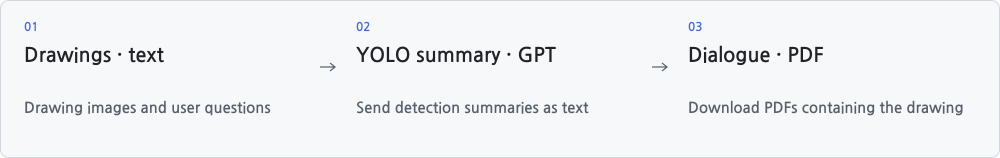
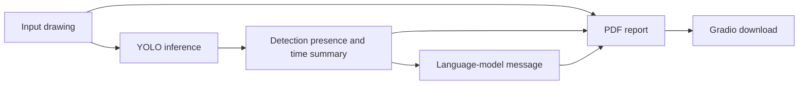
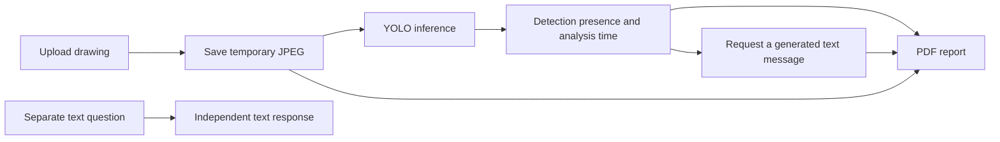

<a name="그림-객체-탐지와-ai-분석-리포트"></a>
<a name="yolo--gradio--대화형-메시지--pdf"></a>

<a id="-drawing-analysis-project"></a>

<!-- readme-header32:start -->
<a name="drawing-analysis-project"></a>
<p align="center"></p>
<h1 align="center" id="project-title">Drawing Analysis Project</h1>
<p align="center">From drawing-detection summaries to dialogue and reports</p>
<p align="center">
  <a href="../README.md"></a>
  <a href="README.md"></a>
</p>
<p align="center">
  <a href="../docs/%EC%9D%BD%EA%B8%B0%EC%95%88%EB%82%B4/%EB%A0%88%EB%B2%A81.md"></a>
  <a href="../docs/%EC%9D%BD%EA%B8%B0%EC%95%88%EB%82%B4/%EB%A0%88%EB%B2%A82.md"></a>
  <a href="../docs/%EC%9D%BD%EA%B8%B0%EC%95%88%EB%82%B4/%EB%A0%88%EB%B2%A83.md"></a>
  <a href="../docs/%EC%9D%BD%EA%B8%B0%EC%95%88%EB%82%B4/%EB%A0%88%EB%B2%A84.md"></a>
  <a href="../docs/%EC%9D%BD%EA%B8%B0%EC%95%88%EB%82%B4/%EB%A0%88%EB%B2%A85.md"></a>
</p>
<p align="center"><small>LEVEL links open the Korean source at the same reading level.</small></p>
<picture>
  <source media="(max-width: 600px) and (prefers-color-scheme: dark)" srcset="../assets/readme/flow-en-dark-mobile.svg" />
  <source media="(max-width: 600px)" srcset="../assets/readme/flow-en-light-mobile.svg" />
  <source media="(prefers-color-scheme: dark)" srcset="../assets/readme/flow-en-dark.svg" />
  <source media="(prefers-color-scheme: light)" srcset="../assets/readme/flow-en-light.svg" />
  
</picture>
<!-- readme-header32:end -->


This project connects YOLO detections with GPT conversations and drawing-analysis PDFs.

<!-- reading-levels17:start -->
| Reading level | What the guide covers |
| --- | --- |
| [LEVEL 1 - Beginner (Korean source)](../docs/%EC%9D%BD%EA%B8%B0%EC%95%88%EB%82%B4/%EB%A0%88%EB%B2%A81.md) | Unfamiliar terms and concrete examples from input to result |
| [LEVEL 2 - Explorer (Korean source)](../docs/%EC%9D%BD%EA%B8%B0%EC%95%88%EB%82%B4/%EB%A0%88%EB%B2%A82.md) | The relationships between key concepts and processing steps |
| [LEVEL 3 - Practitioner (Korean source)](../docs/%EC%9D%BD%EA%B8%B0%EC%95%88%EB%82%B4/%EB%A0%88%EB%B2%A83.md) | Experiment and usage procedures, and how to interpret results |
| [LEVEL 4 - Advanced (Korean source)](../docs/%EC%9D%BD%EA%B8%B0%EC%95%88%EB%82%B4/%EB%A0%88%EB%B2%A84.md) | Code structure, settings, design choices, and constraints |
| [LEVEL 5 - Expert (Korean source)](../docs/%EC%9D%BD%EA%B8%B0%EC%95%88%EB%82%B4/%EB%A0%88%EB%B2%A85.md) | Papers, protocols, denominators, leakage, and unverified scope |
<!-- reading-levels17:end -->

Field: Computer vision and NLP › Connecting detection with language models › Drawing-detection summary → conversation and PDF

`Python`
`YOLO`
`Gradio`

[Quick start](#quick-start) · [Repository structure](#repository-structure) · [Experiment settings](#data-settings)

[Core components](#input-processing-output)

<a id="-주요-개발-내용"></a>

## Implementation overview

The base app connects YOLO drawing detection, text questions, and PDF records.

- analyze_and_suggest passes detections from an uploaded drawing into the analysis/suggestion workflow.
- ask_gpt handles text conversation; build_pdf creates a PDF from the conversation result.
- Separate scripts prepare training materials and train YOLO.

**Materials:** [Base version (Korean source)](../docs/versions/stage-1.md) · [Complete history (Korean source)](../docs/VERSIONS.md)

<a name="preview"></a>

<a name="input-processing-output"></a>

<a id="-입력처리출력"></a>

## Input, processing, and output

| Component | Description |
| --- | --- |
| Problem | Connect drawing detections with text conversation and reports. |
| Input | A drawing image and user text |
| Processing | Connect a summary of whether YOLO detected objects to a GPT-4o-mini text request |
| Output | Conversation messages and a PDF containing the input drawing |

---

<a id="️-차수별-프로젝트-안내"></a>

## All revisions

| Revision or stage | Main content | Materials and comparison with the previous version |
| --- | --- | --- |
| [Base version (Korean source)](../docs/versions/stage-1.md) | The base configuration connects drawing detection, text conversation, and PDF output with data-generation and training helpers. | [Folder](../docs)<br>[Full comparison (Korean source)](../docs/VERSIONS.md) |

<a name="introduction"></a>

<a id="-프로젝트-소개"></a>

## Research method

One Gradio interface connects YOLO inference, language-model message generation, and PDF output. Separate scripts cover drawing-data preparation, YOLO training, JSONL conversion, and fine-tuning tasks.

| Feature | Implementation |
| --- | --- |
| Drawing input | Save a Gradio image input as a temporary image |
| Object detection | Run trained YOLO weights and check whether detections exist |
| Message generation | Request conversational messages from a detection-success/failure summary |
| PDF generation | Assemble the analysis time, summary, messages, and input drawing into a report |
| Data preparation | Drawing generation, patch splitting, and training-label scripts |
| Training tools | YOLO training and JSONL/fine-tuning helper code |



<a name="repository-structure"></a>

<a id="-저장소-구성"></a>

## Repository structure

Main files:

```text
.
├── app.py
├── fastAPI.py
├── config.py
├── synthetic_drawings_generator.py
├── yolo_single_object_dataset.py
├── train_yolo_dataset.py
├── train_yolo_pipeline.py
├── csv_to_jsonl.py
├── fine_tuning.py
├── build_and_finetune.py
└── docs/VERSIONS.md
```

- [Gradio app](../app.py): Input, inference, conversation, and PDF integration.
- [YOLO training pipeline](../train_yolo_pipeline.py): Image splitting, example labels, and training configuration.
- [Drawing generation](../synthetic_drawings_generator.py) and [single-object data preparation](../yolo_single_object_dataset.py).
- [JSONL conversion](../csv_to_jsonl.py), [fine-tuning code](../fine_tuning.py), and [version history (Korean source)](../docs/VERSIONS.md).

<a name="관련-연구와-공개-범위"></a>

<a id="-관련-연구와-공개-범위"></a>

### Related research and public scope

The [Art Therapy Dialogue study](https://github.com/PUVKID/Art-Therapy-Dialogue-Project) explains the same YOLO detection-summary, conversation, and PDF design through its paper and notebook.

This repository preserves the Python code structure, including data generation, training, fine-tuning, and API entry points.

Both cover the same drawing-analysis flow. Here you can inspect Python executables and training helpers; the dialogue-study repository provides the final paper and notebook.

<a id="-주요-기술과-처리-흐름"></a>

## Main technologies and processing flow

`app.py` saves inputs with OpenCV and calls Ultralytics YOLO using `conf=0.05`, `imgsz=640`. The language model receives a text summary containing detection success/failure and analysis time. This workflow does not send the original drawing itself or detailed object coordinates to the language model.

`build_pdf()` uses FPDF to place messages and the drawing in a document.

The result image is the original input drawing without newly drawn detection boxes. `ask_gpt()` handles a separate text-question input.

The requested model name in code is `gpt-4o-mini`; check actual service access in the execution environment.

<a name="quick-start"></a>

<a id="-빠른-시작"></a>

## Quick start

Prepare Python at the repository root.

```powershell
python -m venv .venv
.\.venv\Scripts\python -m pip install gradio ultralytics fpdf2 openai opencv-python
```

1. Set `OPENAI_API_KEY` in your own environment.
2. Set `YOLO_MODEL_PATH`, `PROJECT_DIR`, and `FONT_PATH` in `app.py` to the actual model, working, and font paths.
3. Prepare the input folder corresponding to `INPUT_DIR`. The code creates the output folder.
4. Run the app.

```powershell
.\.venv\Scripts\python app.py
```

Environment variables in `config.py` and the app's own paths in `app.py` are managed separately. Configure weights, drawing input, and font paths for the entry point being run, and prepare service credentials.

<a name="data-settings"></a>

<a id="-데이터-구성과-실험-설정"></a>

## Data and experiment settings

| Item | What to check |
| --- | --- |
| Drawing input | Image to pass to the app and its read/save paths |
| YOLO weights | A model trained for the relevant drawing objects |
| Report | Configured to generate `result/report.pdf` |
| Example training classes | `door`, `roof`, and `tree` in `train_yolo_pipeline.py` |
| Example training settings | 30 epochs, image size 640, batch 8 |

`train_yolo_pipeline.py` creates example labels at fixed positions and uses the same image folder for training and validation. Validation values from this configuration describe fit to training materials; generalization evaluation requires separate ground-truth labels and independent test data.

<a name="함께-보관한-학습-경로"></a>

<a id="-함께-보관한-학습-경로"></a>

### Preserved training workflows

| File | Inputs, outputs, and settings |
| --- | --- |
| <a id="layout18-table-6-row-1"></a> `synthetic_drawings_generator.py` | Combines 33 shape types in an image; configured to generate 50,000 training images and 50,000 validation images with YOLO labels |
| <a id="layout18-table-6-row-2"></a> `yolo_single_object_dataset.py` | Configured to generate 10,000 training and 10,000 validation single-object images for each of 33 classes |
| <a id="layout18-table-6-row-3"></a> `train_yolo_dataset.py` | A separate training loop with image size 512, batch 16, and 30 target-setting iterations in units of 50 epochs |
| <a id="layout18-table-6-row-4"></a> `finetune_samples.py` | Saves 10 directly authored example sentences to CSV |
| <a id="layout18-table-6-row-5"></a> `csv_to_jsonl.py` | Converts CSV `prompt`/`completion` columns to the older JSONL format |
| <a id="layout18-table-6-row-6"></a> `fine_tuning.py` | Uploads a JSONL file to an external API and creates a fine-tuning job |
| <a id="layout18-table-6-row-7"></a> `build_and_finetune.py` | Creates conversational JSONL and invokes data-preparation/training commands from an older CLI |
| <a id="layout18-table-6-row-8"></a> `list_finetuning_jops.py` | Lists the account's fine-tuning jobs |
| <a id="layout18-table-6-row-9"></a> `train_result_check.py` | Runs `conf=0.25` inference on specified weights and one image |
| <a id="layout18-table-6-row-10"></a> `fastAPI.py` | Passes text from a `/gpt` POST request to a separate model request |


These generated-image counts are **targets configured in code**. `train_yolo_dataset.py` copies the training folder when no validation folder exists, and calculates `resume_flag` without passing it to `model.train()`. Connecting training resumption remains an area needing work.

The fine-tuning files use different generations of JSONL formats and SDK/CLI calls. They are preserved separately from the base app and should not be run together without checking current service compatibility. Example sentences are neither actual response data nor validated psychological-assessment criteria.

`ask_gpt()` sends one entered question without automatically appending earlier conversation or drawing-analysis results.

Input images and PDFs use fixed filenames `input/temp.jpg` and `result/report.pdf`. This is not code designed as a service that stores multiple users' materials separately.

Preserve needed results before the next execution.

Generated messages are research-prototype outputs; psychological interpretation of drawings and treatment effects require separate validation.

<a name="troubleshooting"></a>

<a id="️-문제-해결"></a>

## Troubleshooting

| Symptom | What to check |
| --- | --- |
| `OPENAI_API_KEY` error | Whether the running process can read the environment variable |
| Weights-file error | The model path directly specified in `app.py` |
| Input cannot be saved | Existence and write permission of `INPUT_DIR` |
| Korean text fails in PDF | Font-file path and FPDF package configuration |
| No detections | Input, model classes, and confidence settings together |
| API call fails | Service authentication, connectivity, and model-access permissions |

---

A study connecting processing stages from drawing input to report output.

<a id="-실행-경로"></a>

## Execution paths

Run from the repository root. Model, input, and training-material paths are relative to that folder; prepare required models and data before execution.

<a id="️-자료-폴더와-차수별-변화"></a>

## Material folders and revision changes

| Material | Folder | Description and comparison or structure |
| --- | --- | --- |
| Base version | [Material folder](../docs) | [Content (Korean source)](../docs/versions/stage-1.md)<br>[Comparison and structure (Korean source)](../docs/VERSIONS.md) |

<a id="-기본-앱과-학습-보조의-세부-구성"></a>

## Detailed base-app and training-helper structure

<a name="purpose"></a>

<a id="-이-구성에서-하는-일"></a>

## Implementation purpose

After a drawing is uploaded, YOLO checks whether objects were found and summarizes that result and the analysis time as text. `app.py` uses this summary to request empathetic questions/comments from GPT-4o-mini, then saves them to PDF with the input drawing.

The result screen shows the input drawing, generated message, and PDF download.

The text-question area on the right makes a separate request. `ask_gpt()` sends one user question without automatically adding earlier drawing analysis or conversation history.

This should not be described as a system in which the language model directly reads detailed object locations, counts, or psychological meaning.

The materials group the base app, data generation, YOLO training, text-training-data preparation, and API entry points. The drawing-analysis app and the helpers that generate data or request training run through separate workflows.

<a id="-주요-기능"></a>

## Features

| Feature | Actual processing | File to inspect |
| --- | --- | --- |
| Drawing analysis | Convert RGB input to BGR, save a temporary JPEG, and run YOLO | `analyze_and_suggest()` in [app.py](../app.py) |
| Detection summary | Check whether the first inference result has detection boxes and record success/failure and time | `has_det`, `analysis_summary` in [app.py](../app.py) |
| Message generation | Send the detection summary as a text request asking for a 10~15-sentence comment | `client.chat.completions.create()` in [app.py](../app.py) |
| PDF report | Place the summary, generated message, and input drawing in an A4 report | `build_pdf()` in [app.py](../app.py) |
| Separate question | Send one question as an independent text request | `ask_gpt()` in [app.py](../app.py) |
| HTTP entry point | Pass `message` from a `/gpt` POST to a model request | [fastAPI.py](../fastAPI.py) |
| Training helpers | Shape-image/YOLO-label generation, training, and JSONL/fine-tuning request preparation | [Training workflows](#training) below |

<a name="flow"></a>

<a id="-입력--처리--출력"></a>

## Input, processing, and output



| Input | Processing | Output and meaning |
| --- | --- | --- |
| Drawing uploaded to Gradio | Run YOLO at `conf=0.05`, `imgsz=640` | A summary of whether at least one detection box exists |
| Detection presence and analysis time | Text request to `gpt-4o-mini` | A generated counseling-style message, not a validated psychological judgment |
| Summary, message, and input drawing | Create a document with FPDF | `result/report.pdf` |
| One text question | Separate API request | Response to that question |

The drawing-analysis input sent to the language model is text summarizing detection success/failure. This is not a multimodal request sending drawing bytes or detailed box coordinates to the model.

The result image also returns the original RGB drawing without newly drawn detection boxes.

<a name="files"></a>

<a id="-실제-폴더와-모듈"></a>

## Actual folders and modules

```text
.
├── app.py                         # Gradio 그림·질문·PDF
├── fastAPI.py                     # /gpt 텍스트 요청
├── config.py                      # 환경변수 기반 설정
├── synthetic_drawings_generator.py
├── yolo_single_object_dataset.py
├── train_yolo_pipeline.py
├── train_yolo_dataset.py
├── train_result_check.py
├── finetune_samples.py
├── csv_to_jsonl.py
├── fine_tuning.py
├── build_and_finetune.py
└── list_finetuning_jops.py
```

The list above contains execution and helper code. The paths below are inputs/outputs used when the app or training code runs. Having code does not establish that models and data are ready.

| Required runtime location | Purpose |
| --- | --- |
| <a id="layout18-table-11-row-1"></a> `input/` | Folder for saving an uploaded drawing as `temp.jpg`.<br>The app does not create this folder automatically; prepare it first. |
| <a id="layout18-table-11-row-2"></a> `result/` | Report folder created by the app |
| <a id="layout18-table-11-row-3"></a> `drawing_yolo_run/v8_finetune/weights/last.pt` | YOLO weights read by the base app |
| <a id="layout18-table-11-row-4"></a> `yolo_single_object_dataset/` | Training data read by the separate YOLO training loop |
| <a id="layout18-table-11-row-5"></a> `generated/` | Another training workflow that generates 12 patches and example labels |


<a id="️-환경과-설정"></a>

## Execution environment and settings

The base app requires Python, `gradio`, `ultralytics`, `opencv-python`, `fpdf2`, and `openai`. Model weights and a Korean font must be prepared separately. Distinguish SDK calls used by the app, API, and fine-tuning helpers when preparing the environment.

| Setting | Value read by the base app | Where to change it |
| --- | --- | --- |
| <a id="layout18-table-12-row-1"></a> API authentication | Process `OPENAI_API_KEY` | Your execution environment |
| <a id="layout18-table-12-row-2"></a> YOLO weights | `./drawing_yolo_run/v8_finetune/weights/last.pt` | `YOLO_MODEL_PATH` in `app.py` |
| <a id="layout18-table-12-row-3"></a> Working folder | `./` | `PROJECT_DIR` in `app.py` |
| <a id="layout18-table-12-row-4"></a> Temporary drawing/report | `input/temp.jpg`, `result/report.pdf` | `TEMP_IMG_PATH`, `PDF_OUTPUT_PATH` |
| <a id="layout18-table-12-row-5"></a> PDF font | Windows Malgun Gothic font-file path | `FONT_PATH` in `app.py` |


`config.py` defines environment variables `OPENAI_API_KEY`, `YOLO_MODEL_PATH`, and `PDF_OUTPUT_PATH`, but the base app does not import that module and uses its own paths. Inspect the actual entry-point values; setting an environment-variable name alone does not change the app's weights/output paths.

<a name="usage"></a>

<a id="-실행과-사용-방법"></a>

## Running and using the app

Prepare a separate Python environment at the repository root.

```powershell
python -m venv .venv
.\.venv\Scripts\python -m pip install gradio ultralytics opencv-python fpdf2 openai
```

1. Set `OPENAI_API_KEY` in your own environment. Do not put credentials in code or public notebooks.
2. Check actual weights/font locations and update paths in `app.py`.
3. Prepare `input/` and confirm that the temporary drawing and report can be saved.
4. Run the app and open the displayed Gradio address.

```powershell
.\.venv\Scripts\python app.py
```

5. Upload a drawing on the left and select **Generate analysis and counseling message**. Inspect the input drawing, text message, and PDF together.
6. **Counsel** on the right is a separate question. Enter any needed context yourself to continue an earlier question.

`/gpt` in `fastAPI.py` is a separate entry point from the base Gradio app; its SDK calls and model name also differ. Check the file's package compatibility and service permissions before operating a server or submitting fine-tuning requests.

<a name="training"></a>

<a id="-함께-보관한-학습-경로-1"></a>

## Preserved training workflows

| Workflow | Input, processing, and output | Interpretation cautions |
| --- | --- | --- |
| <a id="layout18-table-13-row-1"></a> [Composite drawing generation](../synthetic_drawings_generator.py) | Combine 33 shape types into size-640 images and YOLO labels.<br>The target is 50,000 training images and 50,000 validation images. | This is a code generation target, not an acquired-data count or completion record. |
| <a id="layout18-table-13-row-2"></a> [Single-object generation](../yolo_single_object_dataset.py) | Configure 10,000 training and 10,000 validation single-object images per class | Check names, colors, and placement rules for the 33 classes in the generator. |
| <a id="layout18-table-13-row-3"></a> [12-patch example](../train_yolo_pipeline.py) | Split one drawing into 3×4 patches and create fixed example box labels for doors, roofs, and trees. Settings: 30 epochs·640·batch 8. | Labels are not automatically established ground truth for actual objects; train and val use the same image folder. |
| <a id="layout18-table-13-row-4"></a> [Separate training loop](../train_yolo_dataset.py) | Image size 512·batch16; 30 target-setting iterations in units of 50 epochs | Copy training data if validation data are absent. `resume_flag` is calculated but not passed to training. |
| <a id="layout18-table-13-row-5"></a> [Single-drawing inference](../train_result_check.py) | Infer on specified weights and one input at `conf=0.25` | This differs from the app's 0.05 threshold and is not full-test-set performance. |


Text-training helpers split into [example-sentence CSV generation](../finetune_samples.py) → [older prompt/completion JSONL conversion](../csv_to_jsonl.py), or [conversational JSONL/CLI requests](../build_and_finetune.py). [fine_tuning.py](../fine_tuning.py) requests file upload and fine-tuning-job creation; [list_finetuning_jops.py](../list_finetuning_jops.py) lists jobs.

The 10 example sentences are not actual counseling-response data. Opening or inspecting these files differs from executing paid external requests. Do not run helper code from different SDK/CLI generations together indiscriminately.

<a name="results"></a>

<a id="-결과-읽기"></a>

## Reading results

**Detection success** means at least one detection box exists. It does not establish correct understanding of the whole drawing or clinical judgment of an object's meaning. How to explain detections obtained with a low confidence threshold requires separate evaluation.

Messages are generated text based on a detection summary. A plausible PDF explanation is not validation of psychological state, diagnosis, or treatment effects.

Some training-validation paths reuse training materials, so do not report displayed training metrics as independent test accuracy.

Prepare model weights, input drawings, and a Korean font for the base app.

Configure data-generation/training inputs and outputs separately from app paths.

The related paper and evaluation notebook are available separately in the [Art Therapy Dialogue project](https://github.com/PUVKID/Art-Therapy-Dialogue-Project).

<a name="limits"></a>

<a id="️-알려진-제약과-문제-해결"></a>

## Limitations and troubleshooting

| Symptom or constraint | Cause and what to inspect |
| --- | --- |
| <a id="layout18-table-14-row-1"></a> API-key error at startup | `OPENAI_API_KEY` is read during module initialization.<br>Check the running process's environment. |
| <a id="layout18-table-14-row-2"></a> Weights loading fails | Check that the app's `last.pt` exists and is compatible with the YOLO model. |
| <a id="layout18-table-14-row-3"></a> Drawing cannot be saved | Check `input/` and write permission.<br>A call without an uploaded drawing is not separately handled. |
| <a id="layout18-table-14-row-4"></a> PDF font error | Check the actual Korean font file and FPDF package configuration. |
| <a id="layout18-table-14-row-5"></a> The message is an API-error string | Exceptions are returned as message strings and can enter the PDF unchanged.<br>Distinguish them from successfully generated results. |
| <a id="layout18-table-14-row-6"></a> Earlier drawing/PDF changes | Temporary images and PDFs use fixed filenames.<br>Preserve needed outputs before the next run. |
| <a id="layout18-table-14-row-7"></a> Results from multiple users may mix | The base prototype does not separate request filenames, storage, or concurrency. |
| <a id="layout18-table-14-row-8"></a> Earlier conversation/drawing is absent from the question | `ask_gpt()` sends one entered question as an independent request. |
| <a id="layout18-table-14-row-9"></a> Training is labeled as continuing, but resumption is unclear | The calculated `resume_flag` is not connected to actual `model.train()` arguments. |


<a id="-구성과-변경-기록"></a>

## Structure and change history

This Python configuration groups the base app and data-generation/training helpers. See the [complete structure description (Korean source)](../docs/VERSIONS.md) and [change history (Korean source)](../CHANGELOG.md) for file roles and changes.

---

[Project home (Korean source)](../README.md) · [All materials (Korean source)](../docs/REVISION_INDEX.md) · [Structure history (Korean source)](../docs/VERSIONS.md)

[Complete structure and change history (Korean source)](../docs/VERSIONS.md)

[Changes to the revision guides (Korean source)](../docs/changes/2026-11-03-%EC%B0%A8%EC%88%98%EB%B3%84%ED%94%84%EB%A1%9C%EC%A0%9D%ED%8A%B8%EC%95%88%EB%82%B4.md)
